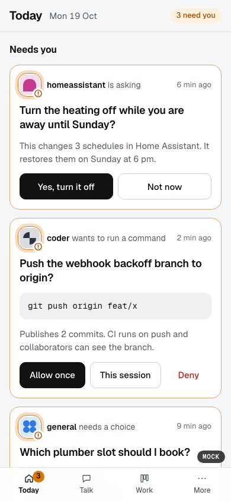

# Caduceus Dashboard

A mobile-first dashboard for [Hermes Agent](https://github.com/NousResearch/hermes-agent). Talk to your agents, answer their approvals and questions, plan and review their work, and look after Hermes, from your phone.

Hermes stays the source of truth. Caduceus launches its own private `hermes serve` on loopback and talks to it only through Hermes's own interfaces (REST, the `/api/ws` JSON-RPC gateway and a few WebSockets). You reach it from your phone over [Tailscale Serve](https://tailscale.com/kb/1312/serve), on your tailnet only.

> **Unofficial.** Caduceus is a personal project. It is not made by or affiliated with Nous Research.

<p align="center"></p>

## What it does

- **Today**: what needs you (approvals, questions, task reviews), work that is ready for review, the day's schedule, and what happened while you were away.
- **Talk**: chat with each agent, with its sessions beside the thread (search, pin, archive, fork). Ask, delegate a background run, or turn a message into a schedule.
- **Work**: everything with a lifecycle by state: waiting on you, running, ready for review, scheduled. Board, tasks, schedules, playbooks and projects.
- **Control**: profiles, keys, channels, memory, skills, files, terminal, git, logs, insights, health, backups and settings.
- **An installable PWA**: works on a phone, a tablet and a desktop; push notifications; offline help.

## Security model

Caduceus can make an AI agent run commands and change files, so its defaults are strict:

- It listens on `127.0.0.1` only. Remote access is through Tailscale Serve (never Funnel), for the Tailscale logins you name.
- Sign-in uses an owner password, then passkeys (WebAuthn).
- **Risk tiers.** Every Hermes operation has a tier in `contracts/policy/`. Anything not in the map is denied. Riskier actions need a confirmation, a fresh passkey check, or a typed name. Every action is audited.
- **A file guard** blocks secrets, credentials, keys and places that run code later (shell startup files, Hermes hooks, skills, plugins).
- Secrets never reach the browser, the logs or share links. A strict CSP is on every answer.

Details: [`AGENTS.md`](AGENTS.md) ("Security rules") and [`docs/design/architecture.md`](docs/design/architecture.md). To report a vulnerability, see [`SECURITY.md`](SECURITY.md).

## Requirements

- macOS. The background service is a LaunchAgent, and Caduceus is built and tested on macOS only. `npm run dev` may work on Linux, but that is untested.
- Node 22.12 or newer.
- Hermes Agent at the version Caduceus is pinned to: see `contracts/hermes/pin.json` (now 0.22.2). With a different version, Caduceus goes read-only until it is re-pinned.
- Tailscale with HTTPS certificates enabled, to use it from your phone.

## Quick start

```sh
git clone https://github.com/SunnySydeUp/caduceus-dashboard.git
cd caduceus-dashboard
npm install
npm run dev        # builds the web app, starts Caduceus on http://127.0.0.1:9130 with a private Hermes
```

Open `http://localhost:9130` on the same machine and set the owner password. This works only from that machine, and only once. Set `CADUCEUS_PORT` to use another port.

Caduceus keeps its own store in `caduceus/` inside the Hermes home (`~/.hermes/caduceus/`, owner-only), so `hermes backup` includes it. **Backups therefore contain Caduceus secrets** (the password hash, sessions and the audit log). For a throwaway run, point `HERMES_HOME` at a temp folder.

## Run it from your phone

```sh
npm run build -w web
npm run caduceus -- setup           # shows the plan and changes nothing
npm run caduceus -- setup --yes     # installs the LaunchAgent; asks again before it touches Tailscale Serve
npm run caduceus -- status
```

Then open `https://<your-mac>.<your-tailnet>.ts.net:9443` on your phone, sign in, add a passkey in Settings › Security, and add the app to your Home Screen. Upgrading, changing who may reach it, uninstalling and troubleshooting: [`docs/RUNNING.md`](docs/RUNNING.md).

## Documentation

- [`docs/USER-GUIDE.md`](docs/USER-GUIDE.md): every screen, risk tiers, keyboard shortcuts, where data lives, backup and restore, troubleshooting.
- [`docs/RUNNING.md`](docs/RUNNING.md): the background service and Tailscale Serve.
- [`docs/STATUS.md`](docs/STATUS.md): open decisions and known limits.
- [`AGENTS.md`](AGENTS.md): the developer guide (layout, commands, test rules, code and security rules). Written for humans and coding agents.
- [`docs/design/`](docs/design/README.md): architecture, information architecture, work model, mobile spec, design system.
- [`docs/research/`](docs/research/README.md): notes on the Hermes protocol, API coverage and other dashboards.

## Develop and test

```sh
npm test           # server and web tests; starts real `hermes serve` processes in throwaway homes
npx tsc -p server --noEmit && npx tsc -p web --noEmit
npm run lint:ui    # design lint: tokens only, no vh, named icon buttons, zoom never locked, reduced motion
npm run test:e2e   # the few Playwright checks; rebuilds web/dist, so never run it while the service runs
```

After a Hermes update, re-pin the contracts: `npm run contracts:regenerate`, then `npm test` names anything that changed. At runtime, `GET /_caduceus/api/compatibility` reports whether the running Hermes still matches the pins.

See [`CONTRIBUTING.md`](CONTRIBUTING.md) before you open a pull request.

## License

[MIT](LICENSE). `contracts/vendor/hermes-shared` is vendored from Hermes Agent under its MIT licence (© Nous Research). The Geist fonts in `docs/design/mocks/desk/fonts` keep their own licence.
