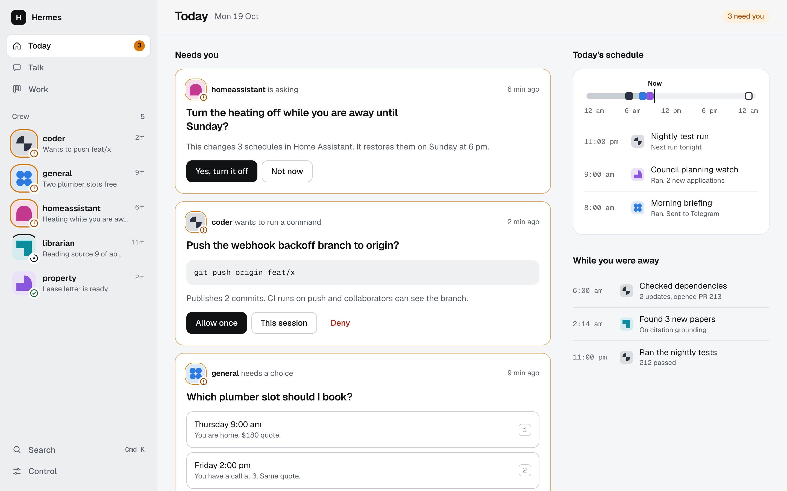
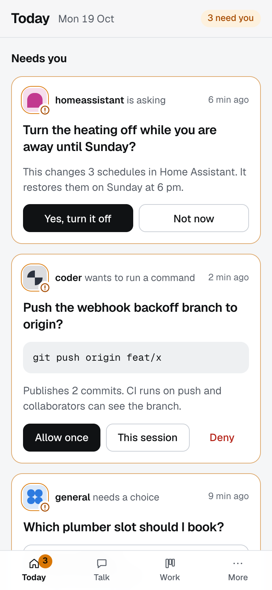
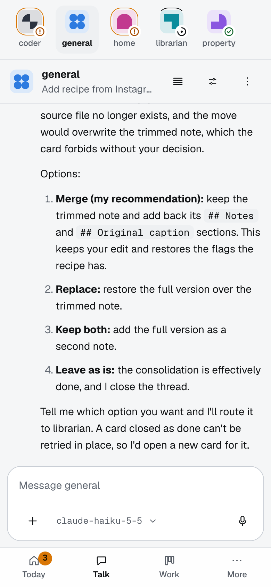
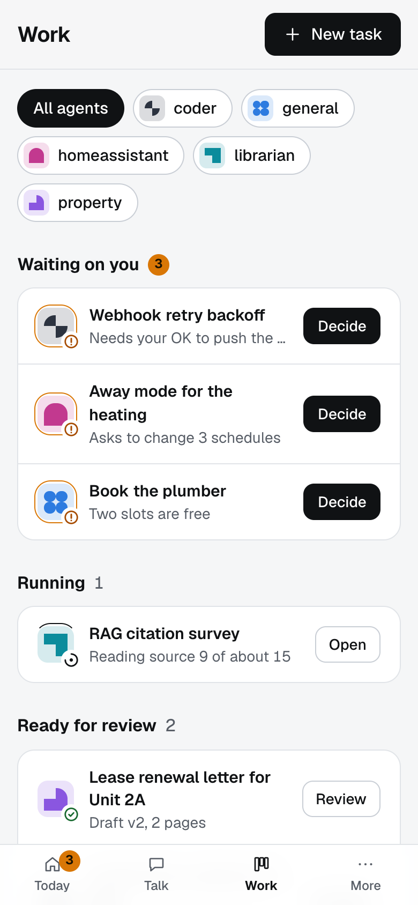
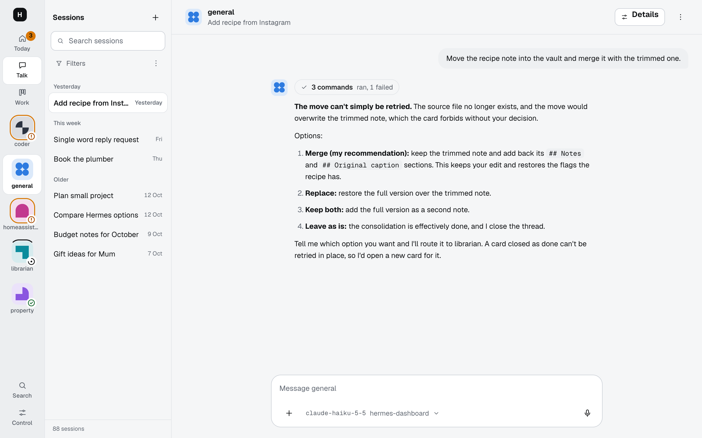
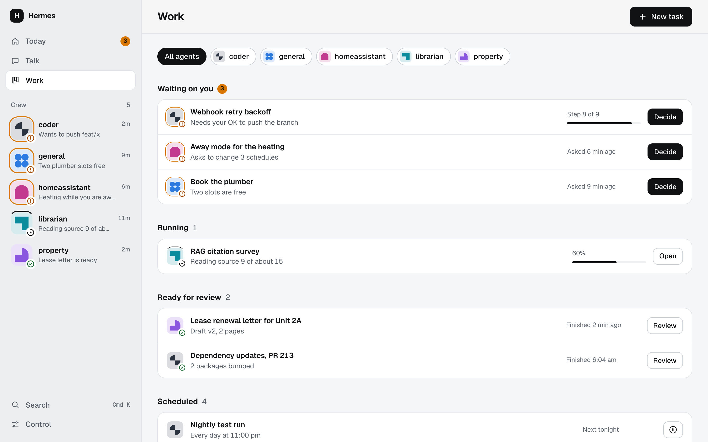
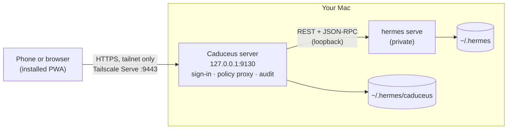

<!-- prettier-ignore -->
<div align="center">


# Caduceus

**Your Hermes agents, in your pocket.**

[](https://github.com/SunnySydeUp/caduceus-dashboard/actions/workflows/ci.yml?query=branch%3Amain)
[](https://github.com/NousResearch/hermes-agent)


[](https://www.typescriptlang.org)
[](LICENSE)

⭐ If you find Caduceus useful, star it on GitHub. It helps a lot!

[Features](#features) • [How it works](#how-it-works) • [Get started](#getting-started) • [Use it from your phone](#use-it-from-your-phone) • [Security](#security) • [Documentation](#documentation) • [FAQ](#faq)

<picture>
  <source media="(prefers-color-scheme: dark)" srcset="docs/images/today-desktop-dark.png">
  
</picture>

</div>

Caduceus is a mobile-first dashboard for [Hermes Agent](https://github.com/NousResearch/hermes-agent). Chat with your agents, answer what they ask, hand them work, review what they finished and keep their schedules, from your phone or any browser. It runs on your Mac next to Hermes and is reached privately over your [Tailscale](https://tailscale.com) network, so nothing is exposed to the internet.

> [!IMPORTANT]
> Caduceus is an independent, community project. It is not made by or affiliated with Nous Research.

## Features

- **Today**: one screen for what needs you right now. Approvals, questions and task reviews are answered in place, next to the day's schedule and what your agents did while you were away.
- **Talk**: a thread per agent with all its sessions beside it (search, pin, archive, fork). Ask a question, delegate a background run, or turn a message into a recurring schedule.
- **Work**: everything with a lifecycle, grouped by state: waiting on you, running, ready for review, scheduled. Board, tasks, schedules, playbooks and projects are views of the same work.
- **Your crew at a glance**: every Hermes profile is an agent with its own sigil and live status line, so you always see who is busy and who is waiting.
- **Control**: profiles, models, keys, messaging channels (Telegram, Slack, WhatsApp), memory, skills, tools, plugins, files, git, logs, insights, health, backups and settings.
- **Built for the phone**: an installable PWA with push notifications, voice input, gestures with visible alternatives, a command palette (<kbd>⌘</kbd> <kbd>K</kbd>) and help on every screen, even offline.
- **Safe by default**: passkeys, risk tiers for every action, a file guard and an audit log. See [Security](#security).

<table>
  <tr>
    <td align="center" width="33%">
      <picture>
        <source media="(prefers-color-scheme: dark)" srcset="docs/images/today-phone-dark.png">
        
      </picture>
      <br><b>Today</b>: decide in place
    </td>
    <td align="center" width="33%">
      <picture>
        <source media="(prefers-color-scheme: dark)" srcset="docs/images/talk-phone-dark.png">
        
      </picture>
      <br><b>Talk</b>: one thread per agent
    </td>
    <td align="center" width="33%">
      <picture>
        <source media="(prefers-color-scheme: dark)" srcset="docs/images/work-phone-dark.png">
        
      </picture>
      <br><b>Work</b>: everything by state
    </td>
  </tr>
</table>

<details>
<summary><b>More screenshots (desktop)</b></summary>
<br>

<picture>
  <source media="(prefers-color-scheme: dark)" srcset="docs/images/talk-desktop-dark.png">
  
</picture>

<picture>
  <source media="(prefers-color-scheme: dark)" srcset="docs/images/work-desktop-dark.png">
  
</picture>

</details>

## How it works

Hermes stays the source of truth. Caduceus starts its own private `hermes serve` on loopback and talks to it only through Hermes's own interfaces: REST, the `/api/ws` JSON-RPC gateway and a few WebSockets. It keeps no copy of your agents' data, only what Hermes has no place for (sign-in, passkeys, the audit log), in `~/.hermes/caduceus/`.



The server is Node.js with [Hono](https://hono.dev) and `node:sqlite`. The web app is React 19, Vite and TanStack Router. Hermes's REST and gateway contracts are pinned in `contracts/` and their types are generated, never hand-written.

## Getting started

### Prerequisites

- **macOS**. The background service is a LaunchAgent. `npm run dev` may work on Linux, but that is untested.
- **[Node.js](https://nodejs.org) 22.12** or newer.
- **[Hermes Agent](https://github.com/NousResearch/hermes-agent) 0.22.2** on your `PATH`. Caduceus is pinned to this version (`contracts/hermes/pin.json`).
- **[Tailscale](https://tailscale.com/download)** with [HTTPS certificates](https://tailscale.com/kb/1153/enabling-https) enabled, to use it from your phone.

### Try it locally

```bash
git clone https://github.com/SunnySydeUp/caduceus-dashboard.git
cd caduceus-dashboard
npm install
npm run dev
```

This builds the web app and starts Caduceus on <http://127.0.0.1:9130> with a private Hermes backend. Open it on the same Mac and set the owner password. This works only from that Mac, and only once. A setup guide then helps you check Hermes, add a model provider and turn on notifications.

> [!TIP]
> To try Caduceus without touching your real agents, point `HERMES_HOME` at an empty folder: `HERMES_HOME=$(mktemp -d) npm run dev`. The first start is slower, because Hermes prepares a separate runtime in that folder. Set `CADUCEUS_PORT` if port 9130 is taken.

## Use it from your phone

Install Caduceus as a background service and expose it on your tailnet:

```bash
npm run build -w web
npm run caduceus -- setup          # shows the plan, changes nothing
npm run caduceus -- setup --yes    # installs the service; asks again before it touches Tailscale Serve
npm run caduceus -- status         # checks the service, Serve and Funnel
```

Then open `https://<your-mac>.<your-tailnet>.ts.net:9443` on your phone, sign in, add a passkey in **Settings › Security**, and add Caduceus to your Home Screen.

> [!WARNING]
> Tailscale's HTTPS certificates are logged in public Certificate Transparency logs, so your Mac's tailnet hostname becomes public. Nothing is reachable from outside your tailnet, but choose the hostname with that in mind.

Upgrading, changing who may sign in, uninstalling and troubleshooting are covered in [docs/RUNNING.md](docs/RUNNING.md).

## Security

Caduceus can make an AI agent run commands and change files, so its defaults are strict:

- **Loopback only.** The server listens on `127.0.0.1`. Remote access is through Tailscale Serve, never Funnel, and only for the Tailscale logins you allow.
- **Passkeys.** Sign in with a password set once on the Mac, then with passkeys (WebAuthn).
- **Risk tiers.** Every Hermes operation has a tier, and anything unknown is denied. Riskier actions need a confirmation, a fresh passkey check, or a typed name. Every action is audited.
- **File guard.** Credentials, keys and places that run code later (shell startup files, Hermes hooks, skills and plugins) are off limits to Caduceus's file tools.
- **No secrets in the browser.** Credentials are masked before they leave the server, and share links redact secrets.

> [!NOTE]
> When Hermes is updated and no longer matches the pinned contracts, Caduceus switches itself to read-only until it is re-pinned. A changed API can never be called by mistake.

Found a vulnerability? Please report it privately, as described in [SECURITY.md](SECURITY.md).

## Documentation

| Guide | What it covers |
|---|---|
| [User guide](docs/USER-GUIDE.md) | Every screen, risk tiers, keyboard shortcuts, where your data lives, backup and restore |
| [Running the service](docs/RUNNING.md) | The LaunchAgent, Tailscale Serve, upgrades and troubleshooting |
| [Status](docs/STATUS.md) | Open decisions and known limits |
| [Architecture](docs/design/architecture.md) | How Caduceus, Hermes and Tailscale fit together, and the security model in depth |
| [Design](docs/design/README.md) | Information architecture, work model, mobile patterns and the design system |
| [Developer guide](AGENTS.md) | Project layout, commands, test rules, code and security rules |

## FAQ

<details>
<summary><b>Do I need Tailscale?</b></summary>

Only to reach Caduceus from another device, such as your phone. On the Mac itself, it works at `http://localhost:9130`, including passkeys. Your phone needs HTTPS for passkeys, push notifications and the installed app, and Tailscale Serve provides it without opening anything to the internet.

</details>

<details>
<summary><b>Does Caduceus replace the Hermes dashboard or Hermes itself?</b></summary>

No. Caduceus runs its own private Hermes backend on your existing `~/.hermes`, beside anything else you already run. Your agents, chats, tasks and schedules stay in Hermes.

</details>

<details>
<summary><b>What happens when I update Hermes?</b></summary>

Caduceus notices that Hermes differs from the version it was built for and turns read-only. Re-pin it with `npm run contracts:regenerate`, run `npm test`, then rebuild and restart. The steps are in [AGENTS.md](AGENTS.md#after-hermes-is-updated-first-done-for-0222).

</details>

<details>
<summary><b>Does it work on Linux or Windows?</b></summary>

Not yet. The background service uses macOS launchd. `npm run dev` may work on Linux, but it is untested.

</details>

<details>
<summary><b>How do I run the tests?</b></summary>

`npm test` runs the server and web tests against real `hermes serve` processes in throwaway homes. `npm run lint:ui` checks the design rules. [CONTRIBUTING.md](CONTRIBUTING.md) lists everything to run before a pull request.

</details>
