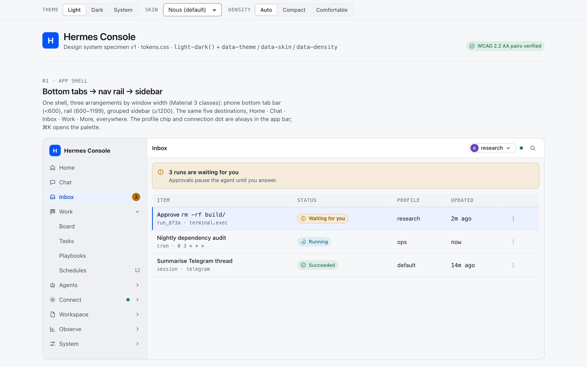
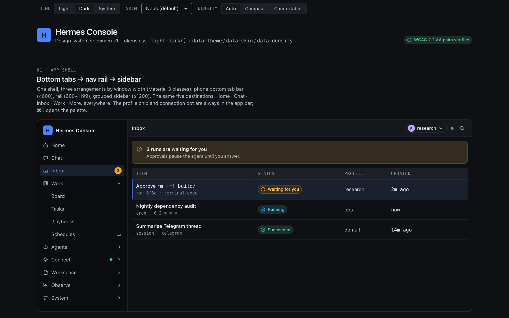
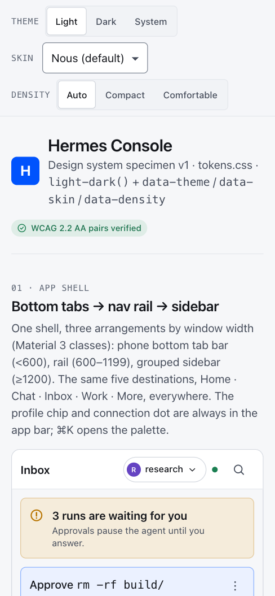
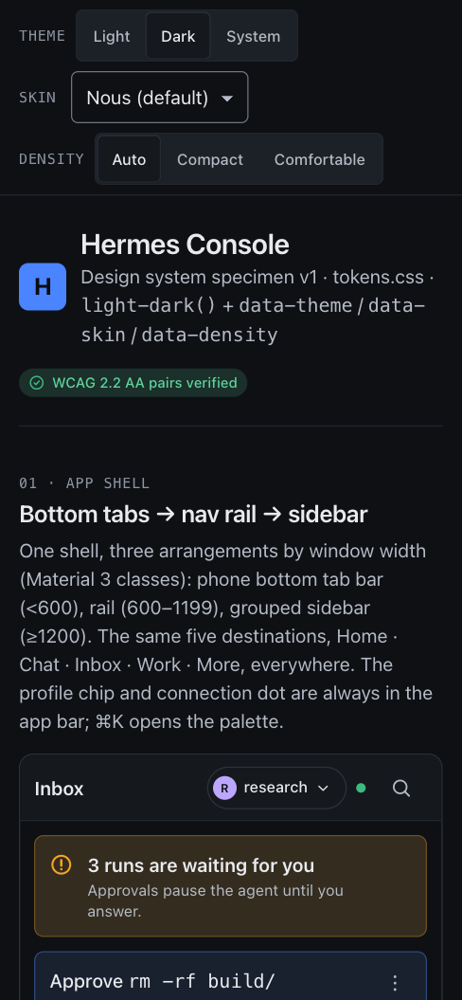

# Caduceus Dashboard: Design System

Status: v1, 2026-10-06. This document owns the visual and interaction contract. The implementation lives in [`tokens.css`](tokens.css), and [`specimen.html`](specimen.html) is the reference rendering. Open the specimen over HTTP (`python3 -m http.server` in this folder); `?theme=dark&skin=hermes&density=compact&motion=reduce` sets every axis.

| Light · 1440 | Dark · 1440 | Light · 390 | Dark · 390 |
|---|---|---|---|
|  |  |  |  |

Full-page captures: `images/specimen-{desktop,mobile}-{light,dark}-full.png`.

Related: [information-architecture.md](information-architecture.md) (shell, navigation, breakpoints), [work-model.md](work-model.md) (task lifecycle that feeds the status ladder), [architecture.md](architecture.md) (stack). Research: [`../research/README.md`](../research/README.md).

---

## 1. Principles

1. **Hermes first, then best-in-class.** The brand comes from first-party Hermes: Nous blue `#0053FD` as an accent skin (Desktop's default skin and the dashboard's Nous Blue theme; the Desk skin is the default), the teal/cream/amber "Hermes Teal" as a heritage skin, mono uppercase overline labels, and flat surfaces with hairlines. Best-in-class comes from rigour: verified contrast, real touch targets, motion that follows state.
2. **Flat, not boxed.** No card inside a card. Group with whitespace and one hairline. Only floating layers get shadows. (Adopted from Desktop `apps/desktop/DESIGN.md:27-31`.)
3. **One primitive per concern; tokens, not literals.** Components never contain hex, rgba, px radii or z-index literals. Variants and sizes own padding, radius and chrome; call sites never override them. (Desktop `DESIGN.md:32-39`; PatterStage design-lint, `../research/patterstage.md:399`.)
4. **Colour never carries meaning alone.** Every status has an icon shape, a text label and a tone. Chart series also differ by dash pattern and carry direct labels.
5. **Machine text is mono.** IDs, model names, paths, cron expressions, token counts, keys and timestamps use mono with tabular numerals. Prose uses the system sans. (PatterStage's "machine words" rule, `../research/patterstage.md:397`.)
6. **Mobile-first, pointer-aware.** Comfortable density with 44 px targets is the base. Compact density only applies with a fine pointer on a window of at least 64 rem. `pointer: coarse` always restores 44 px hit areas.
7. **Motion follows state and never delays it.** Feedback paints in the same frame. Exits are faster than entrances. Reduced motion settles instantly. (Desktop `DESIGN.md:411-426`.)
8. **Logical by default.** Only `inline`/`block` properties are used, so RTL works without a second stylesheet. The specimen includes an Arabic sample.

---

## 2. Lineage: reconciling four visual languages

| Source | What it looks like | Evidence | Kept | Dropped |
|---|---|---|---|---|
| **Hermes Desktop** (first-party, newest) | Neutral greys tinted with Nous blue. Flat panels, `shadow-nous` + 3% hairline on overlays, very small radii (`--radius-scalar: 0.2`), text tiers by alpha, Tabler icons, a named z ladder | `apps/desktop/DESIGN.md:25-44, 80-97, 386-405`; `src/styles.css:155-162, 174-217, 332-335, 465, 551-585`; default skin `nous` (`src/themes/presets.ts:407`) | Default accent (Nous blue), flatness, overlay elevation recipe, z-ladder discipline, Tabler, "never ship Loading…", ConfirmDialog contract, tooltip rules | Desktop-only density: 12 px text buttons and 24 px icon buttons (`src/components/ui/button.tsx:15,45,55-58`) fail touch |
| **Dashboard** (`hermes dashboard`, `@nous-research/ui` "lens") | Brutalist console: uppercase tracked nav, Mondwest/Collapse display fonts, 1 px borders, single-hue palettes from a 3-slot triplet, 15 px root | `web/src/themes/presets.ts:29-82, 203-223`; `web/src/themes/types.ts:62-68`; research `../research/hermes-dashboard.md:308-313` | The "Hermes Teal" identity (`#041c1c` / `#ffe6cb` / amber glow `#ffbd38`) as a skin; mono uppercase overlines; density as a theme axis; theme-YAML compatibility (§4.3) | Uppercase on interactive controls, 28 px segmented controls, alpha-mixed text that is hard to verify |
| **Hermes WebUI** | Gold accent `#FFD700` on navy, or `#B8860B` on cream. 21 skins × light/dark/system. Composer chips | `~/hermes-webui/static/style.css:8-29, 115-126`; research `../research/hermes-webui.md:400-434` | Theme × skin model, light/dark/system, the "Gold" skin, composer chip footer, the phone config sheet | Zoom lock; a light-mode warning toast at about 2.4:1 |
| **PatterStage** | "Cherenkov" cyan on deep blue-black, dark only. Inter + JetBrains Mono. Status ladder. design-lint | `src/app/globals.css:22-60, 226-244`; research `../research/patterstage.md:396-405` | One semantic status ladder kept apart from the chart palette; the machine-words mono rule; 4/8/12 radii; a z ladder gapped by 10; enforcement by lint; "Cherenkov" as a skin | Dark-only; neon glow and scanlines; 24 px hit-target floor (we use 44 on touch) |

**Resulting identity.** The result is a calm operations console. Since the Desk redesign (M8) the default skin, `desk`, lets ink and grey neutrals carry the UI: amber is only for "a person is needed", green and red only for outcomes, primary buttons are ink, and nothing else is coloured but the agents' sigils. The other skins stay: Nous blue is one of them. Section labels are mono uppercase and numbers are tabular mono. Overlays get Desktop's soft drop shadow, and status is always shown with a glyph. Users who prefer the old dashboard look pick the Hermes Teal skin, which also brings the dashboard's neutrals and the optional Collapse display face.

---

## 3. Decision: own primitives, not `@nous-research/ui` components

**Decision.** Build our own primitives on headless Radix (`radix-ui`, the same dependency Hermes Desktop uses) in the shadcn pattern: source lives in the repo and is styled only by `--cd-*` tokens. From `@nous-research/ui` 0.18.2 we take brand assets only: the optional Collapse display font and brand marks. We do not use its components.

**Why.**
- **First-party precedent.** Hermes Desktop, Nous's newest client, imports `@nous-research/ui` in only 3 files, all for fonts or a pixel-art glyph. It builds every control itself as shadcn/Radix (`apps/desktop/components.json`, `src/components/ui/*`, `src/styles.css:68`). The older web dashboard is the one that uses the components (46 files).
- **The aesthetic conflicts with mobile and accessibility needs.** Its `Button` hard-codes uppercase display type with `tracking-[0.2em]`, and inset bevel shadows as arbitrary values (`dist/ui/components/button.js:5-13`). Its `Segmented` is 28 px tall in Mondwest uppercase (`segmented.js:26-31`). Its root palette is amber on brown (`dist/ui/globals.css:155-171`). Retheming that much means overriding most of each component, which breaks "style lives in the primitive".
- **The token model conflicts.** The library derives text tiers by alpha `color-mix` against a 3-colour triplet (`globals.css:122-140`). We need explicit, verifiable pairs for WCAG and for skins.
- **What we lose is small.** Its value is the lens look and Nous fonts, and the Hermes Teal skin reproduces the look on our tokens.

**Shared code we do reuse.**
- `@hermes/shared` `THEME_PRESET_PALETTES` (`apps/shared/src/theme-presets.ts`) imports Desktop and dashboard themes as Caduceus skins (§4.3).
- Tabler icons, as Desktop does (`DESIGN.md:397-405`).
- TanStack Virtual for long lists.
- Observable Plot for charts (architecture.md §stack), themed by the viz tokens.

**Primitive set** (one each): Button, IconButton, Chip, Segmented, Field (Input, Textarea, Select, Search), Switch, Checkbox, Radio, Badge/Status, Count, Sigil, Tooltip, Menu, Popover, Dialog, Sheet, Drawer, CommandPalette, Toast + ToastRegion, Banner + BannerStack, Skeleton, Loader, EmptyState, ErrorState, DataList, Table, CodeBlock, Diff, LogView, Chart wrappers, Kbd.

---

## 4. Foundations

### 4.1 Theming axes and mechanism

| Axis | Attribute | Values | Mechanism |
|---|---|---|---|
| Theme | `data-theme` | `light`, `dark`, `system` (default) | Every colour is a `light-dark(L, D)` pair. The attribute sets `color-scheme`; `system` honours `prefers-color-scheme` |
| Skin | `data-skin` | `desk` (default), `nous`, `hermes`, `gold`, `cherenkov`, `verdant`, `mono` | Overrides accent tokens; `hermes` also overrides neutrals; `desk` also overrides neutrals and the info, running, paused and stale tones (greys); `mono` sets `--cd-radius-scale: 0` |
| Density | `data-density` | `auto` (default), `compact`, `comfortable` | Swaps control, row, gap, padding and UI-text tokens. `auto` = compact when `(pointer: fine) and (min-width: 64rem)` |
| Motion | `data-motion` | `reduce` | Same as the OS `prefers-reduced-motion`: every `--cd-dur-*` becomes 0 ms |
| Text size | `data-text-scale` on `<html>` | `sm` 93.75%, *(none)* 100%, `lg` 112.5%, `xl` 125% | A root percentage that compounds with the browser setting; every size is rem |

- **Scoping.** Every axis also works on a subtree, as in the specimen's theme pair, skin cards and density demo. Derived tokens (`*-soft`, `*-border`, `--cd-bg-selected`, `--cd-viz-seq-*`, shadows) are re-declared on `:root, [data-skin], [data-theme], [data-density]`, so a nested scope recomputes from its own inputs.
- **Why `light-dark()`.** One declaration per token pairs the light and dark values side by side. That makes audits easy and removes duplicated dark blocks. Baseline: Chrome 123, Safari 17.5, Firefox 120. These are acceptable for a 2026 PWA.
- **Caveat: canvas and chart libraries.** Libraries that need concrete colours must resolve tokens through a probe element. Set `probe.style.color = 'var(--cd-viz-1)'` and read `getComputedStyle(probe).color`. Do this again on theme change (watch `matchMedia('(prefers-color-scheme: dark)')` and the attributes).
- **No flash of the wrong theme.** An inline boot script sets `data-theme`, `data-skin`, `data-density` and `data-text-scale` from storage before first paint. The PWA manifest `theme_color` and `<meta name="theme-color" media=…>` use `--cd-bg-canvas` values.
- **Persistence.** Appearance is a per-device preference stored in Caduceus settings (IA §1 Settings). Hermes does not own it, so it does not conflict with decision 1. A device is a browser profile (the `caduceus_device` cookie), not a session, so signing out and in keeps it and two devices stay independent; each also keeps a local copy for the boot script and for offline use ([architecture §2](architecture.md), "Per-device preferences as built").
- **Subtrees and Nous.** Nous is the base of `:root`, which a subtree could never ask for again. So the base colour block also applies, at zero specificity, to any subtree that names a skin other than Hermes Teal, and a skin-neutral reset covers radius and display face: a skin card inside a page in any other skin is drawn in its own skin (Settings › Appearance does this). `web/test/contrast.test.ts` checks every page skin against every card skin.

### 4.2 Colour

**Neutrals** (`light / dark`):

| Token | Light | Dark | Role |
|---|---|---|---|
| `--cd-bg-canvas` | `#f6f7f9` | `#0e1014` | App background |
| `--cd-bg-sidebar` | `#eef0f4` | `#0a0c0f` | Sidebar, rail |
| `--cd-bg-surface` | `#ffffff` | `#15181d` | Cards, panels, lists, tab bar, app bar |
| `--cd-bg-surface-2` | `#f1f3f6` | `#1c2027` | Table headers, wells, segmented track, lanes |
| `--cd-bg-overlay` | `#ffffff` | `#1b1e24` | Menus, dialogs, sheets, toasts |
| `--cd-bg-inset` | `#f3f4f7` | `#0b0d10` | Code, logs, terminal |
| `--cd-fg-default` | `#15171c` | `#e8eaee` | Primary text |
| `--cd-fg-muted` | `#474e5c` | `#b4bac5` | Secondary text |
| `--cd-fg-subtle` | `#5f6775` | `#8d95a2` | Metadata, timestamps, placeholders (still ≥ 4.5:1) |
| `--cd-fg-disabled` | `#9aa1ad` | `#5b626d` | Disabled only (WCAG exempt) |
| `--cd-border-subtle` / `default` | `#e4e7ec` / `#d5d9e0` | `#22262d` / `#2d323a` | Decorative dividers / panel edges |
| `--cd-border-control` | `#7f8794` | `#6d7582` | Input, switch and checkbox boundaries (≥ 3:1) |

**Accent.**
- **Tokens.** `--cd-accent` (fill), `-hover`, `-active` (derived), `-fg` (accent as text or icon), `--cd-on-accent`, `--cd-focus-ring`, plus derived `-soft` (12%), `-soft-hover` (18%), `-border` (45%), `--cd-selection`, and `--cd-bg-selected` (8%).
- **Text on dark accents.** In dark mode the Nous accent `#4a84fe` carries **ink** text (`#0b0d12`, 5.57:1), not white (3.48:1). This follows Desktop's `primaryForeground: '#161616'`.

**Semantic tones** (fixed across skins; skins never recolour state). Each tone has `fg` for text, `solid` for dots, icons and fills, `on` for text on solid, and derived `soft` (14%) and `border` (40%). Tones: `neutral`, `info`, `success`, `warning`, `danger`, `running`, `paused`, `stale`, `blocked`.

**Status ladder.** One vocabulary for runs, tasks, sessions, cron, gateway and devices. It maps from Hermes Kanban `triage → todo → scheduled → ready → running → blocked → review → done → archived`, plus `block_kind` and `gave_up` (work-model.md §1).

| State | Tone | Glyph | Motion | Label | Maps from Hermes |
|---|---|---|---|---|---|
| **Waiting for you** | warning, `--attn` (ring + semibold) | circle with `!` | none (static, never blinks) | "Waiting for you" / "Needs you" | `review`, `blocked`+`needs_input`, live approval, clarify, pairing request |
| Running | running (teal) | open arc + centre dot | spins at 1 s (stops when motion is reduced) | "Running" + elapsed mono | `running`, streaming turn |
| Queued | neutral | circle with three dots | none | "Queued" / "Scheduled · 03:00" | `todo`, `ready`, `scheduled` |
| Paused | paused (violet) | circle with two bars | none | "Paused" | paused cron job, paused playbook, held queue |
| Blocked | blocked (orange) | circle with a bar (no entry) | none | "Blocked · dependency" | `blocked` + `dependency`/`capability`/`transient` |
| Failed | danger | circle with × | none | "Failed" | `gave_up`, failed run, cron failure |
| Stale | stale (sand) | clock | none | "Stale · 2h" | missed heartbeat, scheduler stale, job overdue, drift |
| Succeeded | success | circle with ✓ | none | "Succeeded" / "Done" | `done` |
| Cancelled | neutral | circle with slash | none | "Cancelled" | terminated / interrupted |
| Offline | neutral, **dashed** outline | dashed circle | none | "Offline" | gateway, channel or device offline |
| Draft | neutral | pencil | none | "Draft" | `triage` |
| Online / Degraded | success / warning **dot** | filled dot | optional pulse when streaming | "Online" / "Degraded" | health strip, connection dot |

Rules:
- **Waiting for you** is the only state that gets the attention treatment and the count badge (Today tab, palette, app icon badge).
- Running is the only state that animates.
- Danger red is reserved for explicit failures. Ambiguous exit codes use neutral notices (Desktop `DESIGN.md:337-340`).

**Data visualisation.**
- **Categorical series.** `--cd-viz-1…6` (blue, orange, green, wine, indigo, ink) plus `--cd-viz-other`, `--cd-viz-grid` and `--cd-viz-axis`. The palette came from an optimisation over Okabe-Ito / Tol hue families. It maximises the minimum pairwise ΔE76 under deuteranopia, protanopia and tritanopia simulation (Machado 2009), with every colour ≥ 3:1 against all surfaces (§4.4).
- **Line dash patterns.** Series also carry dashes in the same order: solid, `6 3`, `2 2`, `8 3 2 3`, `1 3`, `10 4`.
- **Sequential.** `--cd-viz-seq-1…5` are viz-1 over the surface at 12/32/54/76/100%. Heatmaps always print a numeric legend.
- **Diverging.** `--cd-viz-div-neg` (viz-2) ↔ `-mid` (surface-2) ↔ `-pos` (viz-1).
- **Fixed series meanings, used consistently:** input tokens = viz-1, output = viz-2, cache read = viz-3, reasoning = viz-4.
- **Never** reuse the status tones as series colours (PatterStage's lesson, `globals.css:226-236`).

**Profile identity.**
- **Sigil.** Profile identity is a sigil, not a colour chip (`web/src/shell/Sigil.tsx`, `sigil-model.ts`). Its tokens are `--cd-sigil-1…7` (slate, blue, magenta, teal, violet, clay, indigo) and derived `--cd-sigil-tile-1…7` (the hue at 17% over the surface). They replace `--cd-avatar-1…8` and `--cd-on-avatar`, which no longer exist. The pattern and the hue come from the name alone (a hash), so a profile looks the same on every screen and device; the owner's five profiles each get a different pattern and hue (tested).
- **Never colour alone.** The sigil is decorative and always sits next to the profile name. The "All profiles" scope uses a neutral glyph. A crew state shows as a ring of its own shape and a badge icon of its own, never by colour alone.

**Code and diff.**
- **Syntax tokens.** `--cd-code-{keyword,string,number,comment,function,type,punct}`.
- **Diff tokens.** `--cd-diff-{add,remove}-{bg,fg}` at 10%, so that the `+`/`−` sign and muted line numbers stay ≥ 4.5:1. Diff lines always carry the sign character.

### 4.3 Skins and theme import

| Skin | Accent L / D | Heritage |
|---|---|---|
| `desk` (default) | ink `#101214` / `#eceef0` (primary buttons and focus ring are ink) on grey neutrals | The Desk redesign (M8 #01): ink and neutrals carry the UI |
| `nous` | `#0053fd` / `#4a84fe` | Desktop default skin; dashboard "Nous Blue"; the base the other skins start from |
| `hermes` ("Hermes Teal") | `#9a5a00` / `#ffbd38` on teal `#041c1c` / cream `#ffe6cb` neutrals | Dashboard default theme (`web/src/themes/presets.ts:68-82`) |
| `gold` | `#8b6508` / `#ffd700` | WebUI default accent |
| `cherenkov` | `#0071c2` / `#00bfff` | PatterStage |
| `verdant` | `#196d31` / `#4f9e5e` | Desktop `github` preset |
| `mono` | ink / paper, radius 0 | Desktop & dashboard `mono` |

**Importing existing Hermes themes.** We stay compatible, but every import passes a contrast gate.
- **Desktop and shared presets** (`THEME_PRESET_PALETTES`, `colors` / `darkColors`):
  - `primary` → `--cd-accent`; `midground` → `--cd-focus-ring` and `--cd-accent-fg`;
  - `background` → canvas; `card` → surface; `popover` → overlay; `foreground` → fg-default; `mutedForeground` → fg-muted; `border` → border-default; `sidebarBackground` → sidebar; `userBubble` → the user-bubble tint.
  - `destructive` is **ignored**: tones are fixed.
- **Dashboard theme YAML** (`~/.hermes/dashboard-themes/*.yaml`; schema at https://hermes-agent.nousresearch.com/docs/user-guide/features/extending-the-dashboard):
  - `palette.background` → canvas; `palette.midground` → accent and fg; `typography.fontSans/fontMono/fontDisplay` → the font tokens; `layout.radius` → `--cd-radius-scale` (radius ÷ 6 px); `layout.density` compact/comfortable → `data-density` (spacious → comfortable + `data-text-scale="lg"`).
  - `componentStyles`, `customCSS` and `assets` are **not** imported, because they are unverifiable.
- **Contrast gate.** After mapping, compute `accent-fg`, `fg-subtle` and `on-accent` against the derived surfaces. Where a pair fails, shift lightness in OKLCH until it reaches 4.5:1 (3:1 for borders and the focus ring), and tell the user the skin was adjusted. Imported skins never change the status tones or viz palette.

### 4.4 Contrast evidence (WCAG 2.2 AA)

The ratios were computed from the token hexes and `color-mix(in srgb)` results (sRGB relative luminance, rounded to the 8-bit pixel). Since M0 #07 they are also enforced: `web/test/contrast.test.ts` reads this file, resolves every token for every theme, skin and density (`system` under a light and a dark OS, `auto` density on a mouse, a narrow window and a touch screen, and a first visit with no attributes) and fails when any pair of the rows below falls under its minimum. The engine reproduces the tables here, which are its independent check. It found two real misses, fixed in `tokens.css`: the light `--cd-viz-other` grey (2.86:1 on surface-2) and the light `--cd-viz-3` green on Hermes Teal's cream surface-2 (2.85:1). The specimen was also audited in Chromium: every rendered text node (678 per page) checked against its composited background, in 12 combinations (light/dark × 6 skins), with **0 failures** (§9).

| Pair | Light | Dark | Needs |
|---|---|---|---|
| `fg-default` on every surface (worst case) | 15.72 | 13.57 | 4.5 |
| `fg-muted` on every surface (worst case) | 7.33 | 8.38 | 4.5 |
| `fg-subtle` on every surface (worst case) | 5.00 | 5.41 | 4.5 |
| `border-control` vs canvas / surface / surface-2 / inset | 3.26 | 3.51 | 3 |

| Skin | accent-fg on surfaces (L / D) | on-accent on accent fill (L / D) | focus-ring vs surfaces (L / D) | accent-fg on accent-soft (L / D) |
|---|---|---|---|---|
| desk | 16.14 / 14.06 | 18.77 / 16.72 | 16.14 / 14.06 (the ring is the same ink as accent-fg) | 14.60 / 11.22 |
| nous | 6.34 / 7.40 | 5.74 / 5.57 | 5.36 / 7.40 | 5.99 / 6.95 |
| hermes | 5.49 / 9.31 | 5.47 / 11.11 | 5.09 / 8.58 | 5.37 / 8.22 |
| gold | 5.71 / 11.65 | 5.30 / 13.53 | 4.94 / 11.65 | 5.56 / 9.65 |
| cherenkov | 5.80 / 10.06 | 5.07 / 8.87 | 4.73 / 10.06 | 5.59 / 8.96 |
| verdant | 6.27 / 8.16 | 6.42 / 5.80 | 5.99 / 8.16 | 5.97 / 7.60 |
| mono | 12.95 / 13.57 | 14.77 / 15.81 | 13.78 / 13.57 | 11.73 / 10.84 |

| Tone | fg on surfaces (L / D) | fg on own soft (L / D) | solid vs surfaces (L / D) | on-solid (L / D) |
|---|---|---|---|---|
| neutral | 6.38 / 8.38 | 6.11 / 7.40 | 4.30 / 5.41 | 4.78 / 6.44 |
| info | 5.57 / 7.60 | 5.27 / 6.75 | 4.29 / 5.39 | 4.77 / 6.41 |
| success | 5.33 / 8.85 | 5.04 / 7.64 | 4.49 / 6.70 | 5.00 / 7.97 |
| warning | 5.55 / 10.14 | 5.40 / 8.54 | 3.41 / 8.01 | 4.73 / 9.52 |
| danger | 5.69 / 7.26 | 5.30 / 6.69 | 4.34 / 4.91 | 4.83 / 5.84 |
| running | 5.56 / 9.30 | 5.35 / 8.06 | 3.53 / 6.90 | 4.57 / 8.20 |
| paused | 6.23 / 7.86 | 5.93 / 6.99 | 4.48 / 5.53 | 4.98 / 6.58 |
| stale | 5.62 / 9.37 | 5.53 / 8.13 | 3.26 / 6.50 | 4.95 / 7.73 |
| blocked | 5.58 / 8.33 | 5.24 / 7.39 | 4.30 / 5.89 | 4.78 / 7.01 |

| Viz palette | Light | Dark |
|---|---|---|
| min contrast vs canvas/surface/surface-2/overlay, over every skin (Nous alone: 3.20 / 4.50) | 3.03 | 3.94 |
| min pairwise ΔE76, normal vision | 45.9 | 49.7 |
| min pairwise ΔE76, deuteranopia | 25.9 | 29.0 |
| min pairwise ΔE76, protanopia | 24.3 | 28.8 |
| min pairwise ΔE76, tritanopia | 24.3 | 29.0 |

`--cd-viz-3` (light) moved from `#00a160` to `#009c5a` and `--cd-viz-other` (light) from `#8a919c` to `#7f8794` so that every series clears 3:1 on every skin's chart surfaces. The darker green costs the light palette about 2 ΔE76 of protanopia and tritanopia separation (the other values are unchanged); the best darkening found keeps the minimum at 24.3.

Other pairs:
- **Hermes Teal neutrals.** fg / muted / subtle, worst case: 14.23 / 7.69 / 5.11 (light) and 11.88 / 9.28 / 6.04 (dark). border-control: 3.05 / 3.64. Status fg on Teal surfaces: ≥ 5.18 / 6.35.
- **Selected row** (8% accent) with fg-subtle metadata: ≥ 4.83 in every skin.
- **Sigils.** Each of the 7 hues on its own tile (the hue at 17% over the surface) is ≥ 3.92:1 in light and ≥ 5.21:1 in dark (`web/test/contrast.test.ts`, pair "sigil on sigil tile").
- **Code colours** on inset and surface: ≥ 4.90 (light) / 5.89 (dark).

### 4.5 Typography

- **Stacks.**
  - `--cd-font-sans`: `system-ui, -apple-system, "Segoe UI", Roboto, …`. This is the same default as Desktop and the dashboard (`web/src/themes/presets.ts:24-35`). There is no web-font cost, and the PWA feels native on iOS and Android.
  - `--cd-font-mono`: `ui-monospace, "SF Mono", "JetBrains Mono", "Cascadia Mono", Menlo, …`.
  - `--cd-font-display`: defaults to sans. The Hermes Teal skin sets `"Collapse"` from `@nous-research/ui/fonts`. Display type appears only on the wordmark and stat numerals. [INFERENCE] Collapse licensing beyond the package's MIT `package.json` is unverified, so check with Nous before shipping it outside self-hosted installs.
  - The ui-ux-pro-max recommendation (IBM Plex Sans + JetBrains Mono) is kept as an **optional** user font choice, not as the default.
  - **Geist was tried and rejected (M8 #01).** The Desk redesign asked to adopt Geist and Geist Mono (one variable woff2 each, 69 KB and 71 KB, `font-display: swap`) only if the budgets held. Lighthouse mobile (`npm run perf`, slow 4G, 4× CPU): with the system stack LCP was 2.28 s; with both fonts LCP was 3.01 s twice, over the 2.5 s budget. Initial JS held (150.5 KB gzip against 170 KB) and CLS and INP were the same. The system stack stays and the font files are not in the repo. Do not add a web font without a `npm run perf` run that keeps LCP ≤ 2.5 s.
- **Scale** (rem; size/leading): xs 12/16 · sm 13/18 · md 14/20 · base 16/24 · lg 18/26 · xl 20/28 · 2xl 24/32 · 3xl 30/36. The floor is 12 px; nothing smaller ships, including tab-bar labels.
- **Density roles.** `--cd-text-ui` is 14 px compact or 16 px comfortable. `--cd-text-prose` (chat) is 15 or 16 px with line-height 1.6–1.65. `--cd-text-code` is 13 or 14 px. `--cd-text-input` is **16 px on every coarse pointer**, which stops iOS zooming on focus.
- **Weights.** 400 / 500 / 600; 700 only for display numerals.
- **Tracking.** −0.011em on headings ≥ xl. The overline is 12 px mono uppercase at +0.06em, the Hermes signature carried over from the dashboard and PatterStage. Uppercase is never used on buttons or body text.
- **Numerals.** `font-variant-numeric: tabular-nums` on tables, timers, costs, counts and stats.
- **Measure.** `--cd-measure` 70ch for prose; `--cd-chat-max` 48 rem for the transcript and composer column.

### 4.6 Space, density and targets

- **Spacing scale.** 4 px grid: `--cd-space-{0,px,0-5,1,1-5,2,3,4,5,6,8,10,12,16}` = 0, 1, 2, 4, 6, 8, 12, 16, 20, 24, 32, 40, 48, 64 px. Section rhythm is 16 / 24 / 40.
- **Page rhythm.** A screen's root is `.main`'s child: the `PageHeader`, then the screen's blocks, `gap: var(--page-gap)`. `--page-gap` is 16 px (set on `.main`); a screen of headed sections or card groups (Channels, Gateway, Pairing, Webhooks, Keys, Health, Settings, Control, Work's landing) sets `--page-gap: var(--cd-space-6)` on its root. The header's bottom padding is `24 px − --page-gap`, so the header always stands 24 px above the first block. A screen never overrides the header's padding. A bordered card or panel pads with `--cd-card-p`, never a fixed step.

| Token | Compact (fine pointer ≥ 64 rem) | Comfortable (default, touch) |
|---|---|---|
| `--cd-control-h` / `-sm` / `-lg` | 32 / 24 / 40 | 44 / 36 / 52 |
| `--cd-row-h` / `-dense` | 44 / 32 | 56 / 44 |
| `--cd-control-px` · `--cd-gap` · `--cd-card-p` | 10 · 8 · 12 | 14 · 12 · 16 |
| `--cd-page-px` · `--cd-appbar-h` · `--cd-icon` | 24 · 48 · 16 | 16 · 56 · 20 |
| `--cd-target-min` | 24 (WCAG 2.5.8) | 24, **44 under `pointer: coarse`** |

**Targets.**
- **Control size.** Controls use `min-block-size: max(var(--cd-control-h), var(--cd-target-min))`.
- **Small visuals.** Chips, switches, chip close buttons and composer chips keep their visual size and grow a transparent `::after` hit area to `--cd-target-min`. The area is computed with logical insets, so it is RTL-safe.
- **Spacing.** Adjacent targets keep ≥ 8 px gaps.
- **Tab bar.** Tab items are 56 px tall (≥ 48, IA §2).

### 4.7 Shape, elevation, layers, motion

- **Radius.** xs 2 · sm 4 (badges, chips, kbd) · md 6 (controls) · lg 8 (cards, panels) · xl 12 (dialogs, sheets, composer) · full. Every value is multiplied by `--cd-radius-scale` (0 for mono). These are crisper than WebUI's 16 px composer and softer than Desktop's ~2 px. Desktop's 2 px reads as hostile on touch.
- **Elevation.** Surfaces are flat by default. `--cd-shadow-raised` is for sticky headers and the selected segment. `--cd-shadow-popover` covers menus, toasts and the dragged card. `--cd-shadow-overlay` covers dialogs, sheets, drawers and the palette; it is Desktop's layered `shadow-nous` recipe plus a theme-aware 10% hairline. Shadow colours are `light-dark()`, so dark mode gets denser shadows. **One deliberate exception:** the navigation floats on every size, so it is the one piece of persistent chrome with a shadow: the phone dock (`overlay`) and the side card and rail pill (`popover`), on a frosted surface. The side card has **one depth cue**: the shadow, whose first layer is already a 1 px ring, so it has no CSS border of its own (a border and a wide shadow together read as two edges).
- **Z ladder** (`--cd-z-*`, gapped by 10): sticky 10 · appbar 20 · nav 30 · banner 40 · scrim 100 · overlay 110 · popover 120 · palette 130 · toast 140 · tooltip 150 · system 200. Plain `z-10`/`z-20` are still fine inside one component (Desktop `DESIGN.md:386-393`).
- **Motion.** fast 100 ms (press, toggle) · base 160 (fade, colour) · moderate 220 (menu, toast in) · slow 300 (sheet, drawer, dialog in) · exit 160 · glide 460 (things that travel: the nav highlight, the page slide, shared elements) · pulse 1600. Easings: `standard (0.2,0,0,1)`, `enter (0,0,0,1)`, `exit (0.3,0,1,1)`, `sheet (0.32,0.72,0,1)`, and `spring` (a `linear()` curve with about 5% overshoot, for things that land: the nav highlight, the dock).
  - Only `transform`, `opacity`, `filter`, `clip-path`, `background-color`, `border-color` and `color` animate. Never `transition: all`, never geometry: a change of layout (a page, the sidebar folding to the rail, a decision leaving) is one View Transition, so the browser moves pictures and the page lays out once.
  - Under reduced motion every duration is 0, `animation: none` applies to spinners, the sheen, the pulse and skeleton shimmer, and no View Transition starts.
- **Moving across the Desk** (the "Desk in motion" overdrive mocks, as built). One idea throughout: what you open grows out of what you tapped, and what you finish goes somewhere.
  - **Page changes** (`useAppNavigate` → the router's View Transition): the old page leaves toward the side it leaves (exit), the new one slides in from the other (glide), by Desk order Today < Talk < Work < Control (`deskTravel`, `web/src/shell/nav-order.ts`). Replacing the address (Talk opening its latest session) never animates. Browser back and forward do not slide.
  - **The highlight travels.** The tab bar, the rail, the sidebar places and the crew each have one highlight inside the current item; it glides to the new item on the spring. The current icon fills lightly.
  - **Crew → Talk.** The pressed crew row's sigil and name fly into the Talk header. Talk's code is preloaded on pointer, press or focus, so the header is there when the browser takes its picture; if it is not, the change is a plain fade.
  - **The sidebar folds** to the rail in one transition: the side panel is clipped, the page slides over.
  - **A decision folds into its agent.** The pressed button confirms in place (a check and the past tense), then the card folds into the agent's sigil on screen (sidebar, rail or Today's crew), else the tab bar's Today count, else the need-you pill; the cards below glide up, and the landing gives a small spring bump. A refused answer keeps the card. An answer cannot be undone, so there is no Undo.
  - **Counts roll** (down when they drop, up when they grow; `RollingNumber`); screen readers get the plain number once.
  - **Depth.** While a bottom sheet is open on a phone, the page behind scales back, rounds and dims (`html[data-sheet-open]`).
  - **Large title hand-over.** On phones the page title shrinks, lifts and fades as it passes under the app bar, ending exactly where the app-bar title fades in (a scroll-driven view timeline, CSS only; nothing changes without `animation-timeline` support).

### 4.8 Layout

- **Breakpoints** (Material 3 window classes, IA §2):
  - `rail` 37.5 rem (600): tab bar becomes the rail.
  - `split` 45 rem (720): list/detail goes two-pane.
  - `sidebar` 75 rem (1200): rail becomes the grouped sidebar.
  - Tailwind's defaults (sm 40, md 48, lg 64, xl 80, 2xl 96 rem) stay. `lg` (64 rem) is also the threshold for `auto` density.
  - Components use **container queries** (DataList restack ≤ 560 px, composer chips ≤ 34 rem, board ≤ 600 px, drawer ≤ 26 rem), so they adapt inside panes.
- **Shell dimensions.** `--cd-tabbar-h` 56 + `--cd-safe-bottom` · `--cd-rail-w` 80 · `--cd-sidebar-w` 256 · `--cd-inspector-w` 352 · `--cd-page-max` 1440.
- **Safe areas.** `--cd-safe-{top,right,bottom,left}` read `env(safe-area-inset-*)`. Use `viewport-fit=cover` and never lock zoom.
- **Viewport height.** Use `dvh`/`svh`, never `vh`, for full-height shells. The keyboard inset comes from `visualViewport` (research §3).
- **Focus not obscured.** `scroll-padding-block-start: var(--cd-appbar-h)` and `scroll-padding-block-end: calc(var(--cd-tabbar-h) + var(--cd-safe-bottom))` on the scroller (WCAG 2.4.11).

### 4.9 Iconography

- **Sets.** Tabler (outline, 1.75 stroke) is the only chrome set; Codicons are allowed inside tool and editor rows, matching Desktop. Sizes come from `--cd-icon` (16 or 20) and `--cd-icon-sm` (14). No emoji, and no sparkles for "AI" (Desktop `DESIGN.md:406-409`).
- **Accessible names.** Icon-only buttons get `aria-label`. Tooltips appear only when hover teaches something new (Desktop `DESIGN.md:165-205`). Never use the native `title=`.
- **Status glyphs.** Status glyphs are part of the ladder (§4.2) and must stay distinguishable in monochrome.

---

## 5. Accessibility contract (WCAG 2.2 AA)

| Criterion | How the system meets it |
|---|---|
| 1.4.1 Use of colour | Status = glyph + label + tone; chart series = dash + direct label; links in prose are underlined; diff lines carry `+`/`−` |
| 1.4.3 / 1.4.11 Contrast | §4.4 tables. Text ≥ 4.5:1; control boundaries, status glyphs and the focus ring ≥ 3:1. Imported skins pass the contrast gate |
| 1.4.4 / 1.4.10 / 1.4.12 Resize, reflow, text spacing | Everything is rem; `data-text-scale` up to 125% plus browser zoom; no horizontal page scroll at 320 px (code, logs, boards and tables scroll inside their own container); no fixed-height text boxes |
| 1.4.13 Content on hover | Tooltips are dismissable (Esc), hoverable and persistent; they are never the only carrier of information |
| 2.1.1 / 2.1.2 / 2.4.3 Keyboard, focus order | Radix primitives: roving tabindex in menus, segmented controls and listboxes; dialogs trap focus, make the background `inert` and restore focus; Esc closes only the topmost layer |
| 2.1.4 Character key shortcuts | Single-key shortcuts (`g`+letter, `j/k`, `?`) can be turned off and remapped (IA §2) |
| 2.4.7 / 2.4.11 Focus visible, not obscured | `outline: 2px solid var(--cd-focus-ring)` with a 2 px offset (outline survives forced-colours mode; box-shadow rings do not); scroll padding clears the sticky app bar and tab bar |
| 2.5.7 Dragging movements | Every drag (kanban card, list reorder, sheet dismiss) has a single-pointer alternative: a "Move to…" menu, up/down actions, or a close button |
| 2.5.8 Target size | 24 px minimum on fine pointers; **44 px** on coarse pointers via `--cd-target-min` and hit-area expansion. Inline text links are exempt |
| 2.2.2 / 2.3.3 Motion | Only the Running glyph loops, and it stops under reduced motion; no flashing; the user can pause streaming charts |
| 3.3.1 / 3.3.2 / 3.3.3 Forms | Visible labels (never placeholder-only), help under the field, errors under the field with an icon and `aria-describedby`; destructive actions use type-to-confirm |
| 3.3.8 Accessible authentication | Paste allowed, passkeys preferred (architecture) |
| 4.1.3 Status messages | One polite `role=status` toast region above the tab bar or composer; errors use `role=alert`; badges announce context ("3 need you"), never a bare number |
| Forced colours | Rely on outline, border and glyph shape; `@media (forced-colors: active)` maps tones to `CanvasText`/`Highlight`/`Mark` [INFERENCE: implementation detail for the primitives] |
| RTL | Logical properties only; direction-sensitive glyphs (chevrons, the approval rail) mirror; the switch thumb translates by the inline direction |

---

## 6. Component inventory

State legend: **R** rest · **H** hover (only under `@media (hover: hover)`; never the only path to an action) · **F** focus-visible · **P** pressed · **S** selected/current · **D** disabled · **B** busy/loading · **E** error · **G** dragging. Every component gets its colours from tokens and its spacing from density tokens.

### 6.1 App shell

| Component | Anatomy & behaviour | States | Phone / tablet / desktop |
|---|---|---|---|
| **App bar** | **Phone only (< 600 px).** Back chevron (or the mark) · the page title once the heading has scrolled away · **profile chip** · connection dot · search · help. Height `--cd-appbar-h` + `--cd-safe-top` | R | Surface background, bottom hairline. From 600 px there is no global app bar: the side card holds scope, search, help and the connection, and a page starts at the top of the window, level with the card's top edge (`--shell-gap` below it) |
| **Scope switcher** | The scope's sigil, the scope's name and a chevron, in the card head (rail: a sigil button with a 12 px label). Opens the profile switcher (a sheet). "All profiles" on cross-profile views; the open agent on Talk; plain text on a screen locked to All profiles (Today). "Make default" lives inside the switcher, never on tap (decision 6) | R H F P S | Phone: the app bar's profile chip (the same switcher) |
| **Heartbeat ring** | The connection, as a ring round the scope sigil: connected = a steady thin success ring · reconnecting = a steady thicker warning ring (never animated: only Running moves) · offline = a neutral dashed ring. Colour is never alone: the scope button's name carries the state ("Profile scope: All profiles. Hermes connected."); when the connection is not healthy the sticky banner says it in words | R | Phone: the app bar's connection dot (`role=status`) |
| **Bottom tab bar (the dock)** | A floating pill of 4 destinations: Today · Talk · Work · More. Only the current tab shows its label (≥ 12 px) on an ink highlight that glides between tabs; the others are icons whose words stay as visually hidden text. Today's count badge = "needs you" only. Talk has a bridge row of sigils above its thread | R F P S | < 600 px only. Shrinks (to 92%, so items stay ≥ 44 px) while scrolling down and returns on scroll up; hides while the keyboard is open; 56 px, inset above the safe area; items 48 px. More opens Control |
| **Navigation rail** | A floating pill (fully rounded, as tall as what it holds, up to the window's height), one `--shell-gap` (12 px) in from the top and start edges; the page starts one gap past it. Top to bottom: the menu or expand toggle · the **scope** (a 44 px sigil button in its heartbeat ring with the scope's name, 12 px, under it, like the other items) · Search · Today · Talk · Work · one sigil per agent (with its state; the only part that scrolls, fading where it is cut) · the fixed foot: Help and Control (with its badge). The menu opens the full Desk as a drawer | R H F P S | 600–1199 px, and the folded sidebar on ≥ 1200 px |
| **Sidebar** | A floating rounded card the window's height, one `--shell-gap` in from the edges, in three parts. **Head:** the **scope switcher** (the scope's sigil in the heartbeat ring, the scope's name, a chevron; opens the profile switcher) and the fold toggle. On Talk the scope is the open agent; on a screen locked to All profiles (Today) it is plain text with the all-profiles mark, no chevron, no button. **Search:** one field, "Search or jump to…" with the ⌘K keycaps, under the head. **Body:** Today · Talk · Work, then the crew (sigil, name, live line, time), the only part that scrolls, with an edge fade where it is cut. **Foot, fixed:** Help (route-aware, `?`) and Control (with its badge). Counts in mono. The current place and the open agent carry a highlight that glides | R H F P S | ≥ 1200 px; folds to the rail pill (remembered per device) in one transition |
| **Page header** | Title (xl/2xl) + one-line prose subtitle that explains consequences + primary action + `?` help | R | Actions overflow into a ⋯ menu on phones |
| **Banner stack** | Highest-priority banner, plus a "+N" pill (IA §3) | see Banner | Phone: under the app bar. ≥ 600 px: the first thing in the page column, level with the card's top; while the connection banner shows it is **sticky** at the top of the window (the connection said in words stays in view; healthy shows nothing), and its height (`--banner-h`) moves `--shell-top` so the page's other sticky parts stand under it |
| **Work views** | One chip per module placed in Work (Overview, Board, Tasks, Schedules, Playbooks, Projects) | R H F P S | Phone: a band under the app bar. ≥ 600 px: canvas tabs at the top of the page column, level with the card's top and aligned to the page's content padding; no band, surface or border |

### 6.2 Navigation and overlays

| Component | Anatomy & behaviour | States | Responsive |
|---|---|---|---|
| **Command palette** | Combobox input (16 px), grouped listbox (Actions, Go to, Sessions, Profiles), keyboard hints, a footer showing the profile scope (Tab switches scope). `aria-activedescendant`. Opens with ⌘K, `/`, or the app-bar button | R F S (`aria-selected` row = `--cd-bg-selected`) B (results skeleton) E (inline "No results" with suggestions) | Full-screen sheet on phones; centred top-third card on desktop; z `palette` |
| **Dialog** | Title (lg) · description · body · footer (secondary then primary; destructive uses danger). Close × with `aria-label`. Confirm dialogs open focused on the safe action, own the pending → done → close beat, and show inline errors (Desktop `DESIGN.md:308-316`) | R B E | At ≤ 600 px it renders as a bottom **sheet** |
| **Sheet** | Bottom on phones: grabber (decorative), title, content; dismiss by swipe, scrim tap or a Close button (2.5.7). Respects `--cd-safe-bottom`. Snap points 50% / 90% [INFERENCE] | R G (dragging) | Phones; the desktop equivalent is a popover or dialog |
| **Drawer** | Side panel from the inline-end edge (run inspector, filters). Modal on phone/tablet (scrim); a non-modal docked pane on ≥ 1200 px | R | Width `--cd-inspector-w` |
| **Menu / popover** | Overlay surface, `--cd-shadow-popover`, items ≥ target, separators, a danger item last. Roving focus, type-ahead | R H F D | Long menus become a sheet on phones |
| **Tooltip** | Inverse surface (fg on surface swapped), 12 px. 200 ms delay, 300 ms warm window, 100 ms exit (Desktop timing) | R | Never on touch-only paths |

### 6.3 Feedback

| Component | Anatomy | Variants / states | Notes |
|---|---|---|---|
| **Toast** | Tone glyph · title · optional mono detail · actions (View / Retry / **Undo**) · dismiss | success, danger (`role=alert`, persists until dismissed), accent (undo); auto-dismiss 5 s (paused on hover/focus) | One region above the tab bar or composer, z `toast`; never covers primary actions; max 3 stacked |
| **Inline banner** | Tone glyph · title · body · actions · optional dismiss; soft tone background + tone border | info (update), warning (degraded), danger (load error + **Retry** + **Copy details**), neutral offline ("reconnecting in 4 s", cached time) | Errors keep the request line (`GET … → 502`) in mono |
| **Empty state** | Icon tile · title · one-sentence explanation · primary action + secondary | — | Uses the page's own primary action; never the bare word "Empty" |
| **Loading** | Skeletons that match the final layout (no CLS); `Loader` for long operations; `role=status` "Loading sessions" for screen readers | shimmer, or static under reduced motion | Never ship the literal text "Loading…" (Desktop `DESIGN.md:296-298`) |
| **Error state** | Glyph · what failed · why · Retry · Copy details · link to Logs | — | One look for route errors, boundary errors and in-dialog errors |

### 6.4 Controls

| Component | Variants | States | Rules |
|---|---|---|---|
| **Button** | primary · secondary · ghost · danger · danger-quiet; sizes sm / default / lg; icon-only | R H F P D B (spinner + label kept, `aria-busy`) | One primary per view. Pressed = `--cd-accent-active` / `--cd-overlay-pressed` in ≤ 100 ms. No layout shift between states |
| **Chip** | filter (toggle, `aria-pressed`), input (removable, × with its own label), profile, composer-setting | R H F P S D | Visual 24/36 px, hit area ≥ target |
| **Segmented** | 2–5 options, `role=radiogroup` | R H F S D | Each segment ≥ target in both dimensions |
| **Text field** | label · input · help · error; prefix icon; kbd hint; mono variant for machine values | R F (border = ring colour + 2 px outline) E (`aria-invalid`, danger border, message with glyph) D | 16 px text on touch; `autocomplete` set; password fields allow paste |
| **Select** | Native `<select>` on phones; Radix Select/Combobox with search on desktop for long lists (models, providers) | R F D E | — |
| **Textarea / composer input** | Auto-grow up to 40% of the viewport | R F D | — |
| **Switch** | Track 40×24 + thumb; on = accent | R F D (locked shows the reason in the label) | Hit area ≥ target; the label is the whole row |
| **Checkbox / radio** | 18 px box, ≥ 3:1 border | R F checked indeterminate D | The label row is the target |
| **Kbd** | 20 px mono key cap | — | Shown only where a keyboard exists (`@media (hover:hover) and (pointer:fine)`) |

### 6.5 Data and work

| Component | Anatomy | States | Phone behaviour |
|---|---|---|---|
| **Status badge** | Glyph + label in a soft pill; `--plain` (no fill) for dense rows; `--solid` for counts; `--attn` for "waiting for you" | per ladder | Never truncate the label; truncate the neighbouring title instead |
| **Count badge** | Pill, tabular numerals, warning solid (or accent) | — | Accessible name gives context |
| **Data list / table** | Sticky mono-overline header, `--cd-row-h` rows, hairline separators, selection rail (2 px accent on the inline-start edge), row actions in ⋯ | R H F S (8% accent) B (skeleton rows) E (row-level error glyph) | **Restacks to cards** below a 560 px container: title + sub on the first line, status, then `label: value` pairs, ⋯ top-end. Table semantics kept with explicit ARIA roles. Virtualised with TanStack Virtual |
| **Kanban board / lane** | Lanes on surface-2 with mono overline + count + add | — | Phone: a status **segmented control** over one vertical list (work-model §3). Long-press or "Move to…" moves cards |
| **Kanban card** | Mono ID · status (plain) · title · meta (profile chip, playbook, stage, elapsed, tokens) · progress | R H F S (accent ring) G (popover shadow, −1.5° tilt, cancelled by reduced motion) **attention** (3 px warning edge on the inline-start side) | "Move to…" button always present for 2.5.7 |
| **Run timeline / step** | Ordered list; 24 px tone disc with glyph; title, sub, mono time at the inline end; a 2 px connector | per ladder; the running step shows live elapsed time and the current command | Same |
| **Tool-call card** | `
`: chevron · status glyph · tool name (mono) · args summary (mono, truncated) · duration; body = LogView or preview | collapsed, expanded, running (spinner), **failed** (danger border, reason in place of duration) | Height-capped body that hands scroll back to the thread at its edges (Desktop `DESIGN.md:341-346`) |
| **Approval card** | Waiting-for-you badge · profile · run · age; question ("Allow `terminal.exec`?"); the exact command in an inset block; consequence sentence with flags; actions **Allow once** (primary, ↵) · This session · Always… · Deny (danger-quiet) | R F B (after a decision: pending → resolved, card retires) | The same component in Talk (inline above the composer), on Today (Needs you, `DecisionCard` over `InboxDecision`), in the Talk tray (compact, for other agents and other sessions), and as a sheet from a push deep link. Gestures never grant approval (Desktop `DESIGN.md:99-119`) |
| **Clarify card** | Same shell as Approval; choices as chips plus a free-text field and an optional countdown | as Approval | — |
| **Agent turn** | Byline (sigil, profile, mono model) · collapsible "Thought for 12s" · prose (no bubble) · actions (copy, fork, regenerate) | streaming caret (running tone), error turn | Full width |
| **User message** | Accent-tinted bubble (9% fill, 18% border), at the inline end, tail corner sm | editing | Max 85% width |
| **Composer** | Textarea · chip footer (profile, model mono, reasoning effort, workspace mono, context ring with %) · attach · dictate · send (primary icon) | R F (accent border + 35% ring) D B (send becomes Stop; busy modes Queue / Interrupt / Steer) | Chips fold into **one settings chip** that opens the Chat settings sheet when the composer is narrower than 34 rem |
| **Code block** | Header (file, language, Copy) · inset `pre` with syntax tokens | — | Horizontal scroll inside the block |
| **Diff** | Header (+N / −M, Open) · gutter line number · sign column · tinted line | — | Same |
| **LogView** | Inset, mono `--cd-text-code`, no extra chrome, level glyph + colour, `role=log` | live (auto-follow only near the bottom) | — |
| **Charts** | Observable Plot with the viz tokens; direct labels; a legend that includes dash samples; grid `--cd-viz-grid`; axis text mono 12 px; a visually hidden data table or summary | hover/focus tooltip, empty, loading (skeleton) | Fewer ticks; a legend below |
| **Stat tile** | Overline label · display numeral (tabular) · delta or budget bar · sparkline | — | Two per row |
| **Sigil** | A 2 × 2 mark of four cells (full square, circle, one-round-corner square, or empty) in one of 7 hues, both drawn from the profile name (`web/src/shell/Sigil.tsx`, `sigil-model.ts`); sizes xs, sm, md, lg, xl. With a crew state it gets a ring and a corner badge. Decorative (`aria-hidden`); the state's words sit beside it. `data-profile` names the profile, so that an answered decision can fold into its agent (`modules/today/fold.ts`) | waiting: steady ring (never blinks), waiting badge · working: faint full track with a soft sheen travelling round it (no run has a progress, so the ring is never partly full; the sheen stops when motion is reduced), running badge · done: solid ring, succeeded badge · blocked: dashed ring, failed badge · idle: none | Always next to the name. `all` shows the scope icon |

---

## 7. Content rules

- **Case and register.** Sentence case everywhere. Mono overlines are the only uppercase. Copy is plain and honest, following PatterStage's register rules (`../research/patterstage.md:403`): subtitles explain consequences ("Updating restarts the gateway"), and errors say what failed, why, and what to do.
- **Status vocabulary.** Labels come only from §4.2 (Waiting for you, Running, Queued, Paused, Blocked, Failed, Stale, Succeeded, Cancelled, Offline, Draft, Online, Degraded).
- **Destructive actions.** The verb names the object ("Delete profile"), never "OK". Irreversible operations (delete profile, restore, prune, update) need type-to-confirm.

---

## 8. Governance

- **One source per concern.** Tokens live in `tokens.css` and primitives in `src/ui/*`. Changing a token or variant updates this file in the same change (Desktop's rule, `DESIGN.md:13-23`).
- **Lint gates** (adapted from PatterStage `scripts/tooling/design-lint.mjs`):
  - no raw colours, alpha, px radii or z-index outside `tokens.css`;
  - no `transition: all`;
  - no physical properties (`left`, `margin-left`, `padding-right`, `text-align: left`…);
  - no native `title=` on buttons, no `window.confirm`;
  - icon-only buttons need `aria-label`;
  - text below 12 px fails.
- **CI checks.** The token contrast pairs run in `npm test` (`web/test/contrast.test.ts`, §4.4). Browser gates (AGENTS.md: a repeatable smoke check rather than Playwright tests) at 390×844 and 1440×900, light + dark, in every skin:
  - zero horizontal overflow;
  - every interactive element ≥ 44 px under the coarse-pointer project;
  - rendered-contrast audit (§9 method) for every skin;
  - axe-core;
  - reduced-motion snapshot (no running animations).
- **Specimen.** `specimen.html` is the visual regression baseline; screenshots live in `images/`.

---

## 9. Verification performed

| Check | Method | Result |
|---|---|---|
| `tokens.css` parses as CSS | `lightningcss` CLI | OK |
| Tailwind v4 bridge | `@tailwindcss/cli` 4.3.3 compile of `@import "tailwindcss"; @import "./tokens.css";` with sample classes (`bg-surface`, `text-fg-muted`, `border-edge-control`, `rounded-control`, `shadow-overlay`, `z-toast`, `h-control`, `ease-sheet`, `bg-avatar-3` (now `bg-sigil-3`: the bridge maps `--color-sigil-1…7`), `rail:`/`split:`/`sidebar:` variants, `dark:` custom variant, `bg-accent/20`) | All utilities generated and pointing at `--cd-*` variables |
| Rendered text contrast | In Chromium, for every text node in `<main>`, composite the foreground over its nearest opaque background chain and compare against 4.5:1 (3:1 for large text). 12 combinations: light/dark × 6 skins | 678 nodes each, **0 failures**. The first run caught diff gutter numbers (4.25:1) and selected rows in the dark gold/mono skins (4.32:1); both were fixed in the tokens |
| Token contrast gate (M0 #07) | `web/test/contrast.test.ts` in `npm test`: every §4.4 pair (text 4.5:1; borders, focus ring, status dots and chart series 3:1) resolved from `tokens.css` for every theme × skin × density × device (258 environments since the Desk skin joined: 4 themes × 7 skins × 3 densities × 3 devices, and the first visit), the ratios cross-checked against the tables above, and each skin card against each page skin | 0 failures after the two viz fixes in §4.4. Rendered contrast was also re-checked with axe in every skin, light and dark, on every route (744 runs, `.scratch/m0-foundation/m0-07-smoke/`, before the Desk skin) |
| Target size | With `--cd-target-min: 44px` forced (coarse emulation), measure every interactive element, including `::after` hit areas | All ≥ 44 × 44 except inline prose links (exempt under 2.5.8) |
| Reflow | `scrollWidth == clientWidth` at 390 px, light and dark | No page overflow |
| System theme / reduced motion | Emulated `prefers-color-scheme` and `prefers-reduced-motion` | Canvas follows the OS; durations become 0 ms; spinners stop |
| Screenshots | 1440×900 and 390×844 (DPR 1.25 capture), light and dark, viewport + full page | `images/specimen-*.png` (8 files) |

---

## 10. ui-ux-pro-max inputs (accepted / rejected)

Queries run from the skill directory:
- `--design-system "AI agent operations console dashboard developer tool" --density 8 --variance 3 --motion 3`;
- `--domain ux` for colour-only status, target size, focus not obscured, reduced motion, bottom nav, table→cards, toast live region;
- `--domain color`, `--domain typography`, `--domain chart` (real-time, colour-blind);
- `--stack react` and `--stack html-tailwind`.

- **Accepted:**
  - Swiss/minimal style with high contrast and visible focus;
  - the dense spacing dial (8–32 px rhythm);
  - status = icon + text, and an atomic, contextual live status for badges ("3 need you");
  - WCAG 2.2 distinctions: 24 px target minimum on web (AA) versus 44/48 platform touch guidance, which we apply on coarse pointers; Focus Not Obscured (Minimum) via scroll padding;
  - charts: direct labels, dash/marker redundancy, table fallback, pause for streaming charts;
  - Tailwind v4 `@theme` colour namespaces rather than `bg-[var(--x)]` arbitrary values;
  - exits faster than entrances.
- **Rejected:**
  - the "FAQ/Documentation Landing" pattern (off-product);
  - the slate + run-green palette (generic; it conflicts with the Hermes identity and would make green ambiguous between "accent" and "succeeded");
  - "light mode default" as an anti-pattern (we follow the system theme);
  - JetBrains Mono for headings (mono is reserved for machine text);
  - GSAP scroll reveals (a console needs no scroll choreography, and they add JS weight).

---

## 11. Open items

- Collapse font licensing for redistribution [INFERENCE: needs confirmation from Nous].
- Exact sheet snap points and swipe thresholds will be tuned on devices during M0.
- Forced-colours mappings will be specified in the primitives; outline-based focus already survives.
- Skin import: whether to read `~/.hermes/dashboard-themes/*.yaml` automatically or only on request (a privacy and UX choice, not a visual one).
