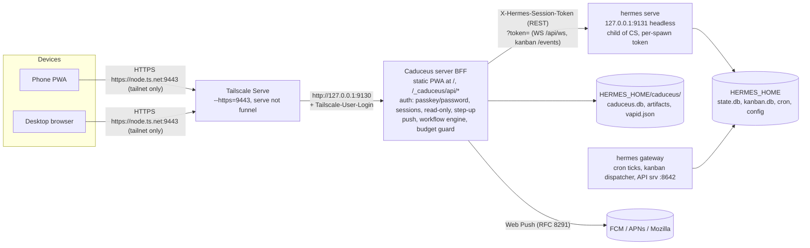

# Caduceus Dashboard: Hermes API coverage, companion backend and hosting/auth

Research date: 2026-10-06. Hermes Agent checkout `~/.hermes/hermes-agent` (v0.21.4). Everything here was read-only: source code, the OpenAPI dump at `/tmp/dashboard-research/hermes-openapi.json`, non-secret config keys, `tailscale serve status`. No prompts, mutations or restarts.

Path shorthands used below:

| Shorthand | Means |
|---|---|
| `HA/` | `~/.hermes/hermes-agent/` |
| `wr/x.py:N` | `HA/hermes_cli/web_routers/x.py`, line N (route decorator) |
| `KB:N` | `HA/plugins/kanban/dashboard/plugin_api.py` line N. These routes are mounted under `/api/plugins/kanban` |
| `RPC method.name` | JSON-RPC method over `/api/ws`. It is declared in `HA/apps/shared/src/gateway-contract.openrpc.json`: 219 methods, 69 notifications (`x-notifications`), 12 server→client requests (`x-server-requests`) |
| `API-srv` | Hermes API server, the messaging gateway's HTTP listener (default :8642, Bearer `API_SERVER_KEY`). Route table at `HA/gateway/platforms/api_server.py` `_http_route_table` |
| `cfg:key` | `config.yaml` key, with its default in `HA/hermes_cli/config_defaults.py:N` |

---

## 0. Findings that affect decisions

1. **Hermes already covers about 85% of the non-chat matrix.** Of 336 REST operations, 201 are called by the stock dashboard UI (path-level match, method below). The other 135 exist but have no dashboard UI. Many of those are "free wins" that Hermes Desktop already uses: git (21 routes), `/api/fs/*` preview/edit, projects, learning graph, cron run history, profile export/import, custom endpoints, timeline/around, and skill uninstall.
2. **The JSON-RPC surface on `/api/ws` adds what REST lacks**, and the stock dashboard SPA uses almost none of it (only `session.create`, `session.info`, `model.options`, `config.set`, `prompt.submit`, `session.events.since`). It provides:
   - projects (17 methods)
   - checkpoint diff/restore (`rollback.*`)
   - session fork (`session.branch`)
   - goals (`session.control`)
   - subagents and delegation
   - `todo.updated`
   - handoff to messaging (`handoff.*`)
   - foreign (Claude Code / Codex) import
   - `llm.oneshot`
   - global change signals: `cron.changed`, `sessions.changed`, `platforms.changed`, `pairing.changed`
3. **Session pins, archive, hidden and unread live in Hermes** (`PATCH /api/sessions/{id}`, `wr/sessions.py:682-703`). So do projects (`RPC projects.*`). The WebUI-style projects/pins row is not a GAP.
4. **Kanban is a strong substrate for Missions and Composer.** It already has the parts listed below. There is **no workflow engine and no templates**, and the kanban schema reserves `workflow_template_id`/`current_step_key` "for v2 workflow routing", which "the dispatcher doesn't consult… yet" (`HA/hermes_cli/kanban_db.py:912-915`).
   - triage (draft), ready (queue) and `scheduled` statuses (`kanban_db.py:103`)
   - parent dependencies
   - a `review` lane
   - typed blocks, including `needs_input` (`kanban_db.py:107`)
   - `goal_mode`
   - per-task skills, model, provider and effort overrides
   - `max_runtime_seconds` (`KB:379-397`)
   - decompose and specify
   - swarm topologies (`HA/hermes_cli/kanban_swarm.py:1-14`)
   - a dry-run dispatcher (`KB:1230-1234`)
5. **True GAPs are few and all dashboard-owned:**
   - drafts
   - saved prompts
   - share links
   - mission templates
   - workflow definitions/runs and their engine
   - artifacts
   - Web Push
   - a spend budget with a hard stop
   - UI preferences
   - passkeys, session list/revoke and read-only mode
   - plus optional items: Hindsight browser, external notes, file move/rename, raw shell
6. **A PWA on a different origin cannot use the dashboard API.** Three things block it:
   - CORS allows only `localhost`/`127.0.0.1` origins (`HA/hermes_cli/web_server.py:388-395`).
   - Gated-mode cookies are host-scoped and `SameSite=Lax` (`HA/hermes_cli/dashboard_auth/cookies.py:3,59-63`).
   - The WS `Origin` must match the bound host or the `dashboard.public_url` host (`HA/hermes_cli/web_server_chat.py:165-189`).
   
   Caduceus must therefore be **served same-origin** with whatever exposes `/api/*`.
7. **Approvals push needs to sit in the session's process.** Live sessions belong to the backend process that hosts them (`RPC session.active_list`: "Live sessions in this process"). Approvals and clarify prompts are server→client requests on the owning connection. A Web Push notifier for approvals must therefore observe the Hermes backend connection that carries the user's chat. Only a backend-for-frontend (BFF) can do that. A side-car that only *reads* Hermes cannot. **[INFERENCE: multi-connection attach semantics not verified; see §8.]**
8. **A Hermes dashboard plugin backend is a poor home for the companion:**
   - It is mounted once at import time, so updates need a dashboard restart, and a restart drops in-process chat sessions and PTYs.
   - It runs in-process with the agent's event loop and Python environment.
   - It has no backend contract version.
   - Internal import paths are explicitly "not a stable API" (`HA/COMPAT_MANIFEST.md:3-6`).
   - It is mounted in *every* backend process, Desktop's `hermes serve` included, so background loops run more than once.
   - Static assets are served `no-store`, with no SPA fallback and a suffix allowlist.
9. **Recommended topology:** a TypeScript **Caduceus server** (BFF) bound to `127.0.0.1`.
   - It is exposed tailnet-only by **Tailscale Serve HTTPS on a port that Funnel cannot use** (for example `:9443`).
   - It serves the PWA at `/`.
   - It owns Caduceus auth (passkeys, sessions, read-only mode).
   - It proxies `/api/*` and `/api/ws` to a loopback `hermes serve` child that it spawns with a per-spawn `HERMES_DASHBOARD_SESSION_TOKEN`. This is the same launcher contract Hermes Desktop uses (`HA/hermes_cli/env_loader.py:57-62`).
   - It stores Caduceus data in `$HERMES_HOME/caduceus/`, which Hermes's own backup includes automatically.
10. **The live deployment fails the PWA requirements today.** It is a plain-HTTP bind on the tailnet IP (launchd `hermes dashboard --host 100.64.0.10 --port 9119`), so it is not a secure context: no service worker, push, WebAuthn, mic or clipboard. Tailscale Funnel already owns `:443` on this node for another service, and the Serve and Funnel modes cannot share a port (Tailscale docs, Limitations: <https://tailscale.com/kb/1312/serve>).
11. **About 40 endpoints and RPC methods are effectively code execution, secret disclosure or irreversible deletion** (§7). One example is `POST /api/fs/write-text`, which overwrites any regular file the user can write. The read-side sensitive-path guard does not apply to it (`wr/files.py:92-103,649-690`). Caduceus needs step-up re-auth and typed confirmation for these, enforced in the BFF and not only in the UI.

---

## 1. Method and legend

**Hermes interfaces inventoried**

- REST: 336 operations from the OpenAPI dump, checked against the router source (`wr/*.py`, `KB`, `HA/hermes_cli/dashboard_auth/routes.py`).
- WebSockets (`wr/chat_ws.py`):
  - `/api/ws` JSON-RPC gateway (:573)
  - `/api/pty`, which runs the TUI (:432)
  - `/api/console`, a restricted `hermes>` console (:271)
  - `/api/pub` and `/api/events`, the per-PTY sidecar event fan-out, not a global bus (:594-644)
  - `/api/audio/speak-stream` (`wr/audio.py:372`)
  - kanban `/api/plugins/kanban/events` (`KB:1717`)
- JSON-RPC: the 219 methods and 69 notifications of the OpenRPC contract.
- API-srv: runs, sessions, `/api/jobs` cron and OpenAI-compatible routes.
- The `hermes` CLI.

**How USED was determined.** A script cross-referenced every OpenAPI path with:

- `HA/web/src/lib/api.ts` members (171 functions; 169 are referenced from non-test UI code);
- literal `/api/` strings in non-test `web/src`;
- `${API}/…` strings in the bundled kanban UI (`HA/plugins/kanban/dashboard/dist/index.js`).

Matching is per path, not per method. So `PUT /api/mcp/servers` counts as USED even though the UI only GETs and POSTs, and these cases are corrected by hand in the tables. Desktop usage comes from a grep of `HA/apps/desktop/src` and `apps/shared/src`.

| Status | Meaning |
|---|---|
| **USED** | Hermes backs it and the stock dashboard UI (or its bundled kanban UI) calls it |
| **UNUSED** | Hermes backs it (REST / WS / RPC / config key) but no stock dashboard UI uses it. Often Desktop or the TUI does |
| **PARTIAL** | Hermes backs part of it. The remainder is a GAP (see Notes) |
| **GAP** | Hermes has nothing. Needs Caduceus client or the companion backend |
| **CLIENT** | A pure client concern; no server backing needed |
| **N/A** | Out of scope by user decision (§Context decisions 1, 5, 7, 8) |

---

## 2. Coverage tables

### 2.2 Sessions & history (admin rows only; chat is out of scope here)

| Capability | Hermes backing | Status | Notes |
|---|---|---|---|
| Full-text search of message bodies | `GET /api/sessions/search` (`wr/sessions.py:254`); `RPC session.list` | USED | FTS5. Root-session dedupe in the handler (`wr/sessions.py:353-370`) |
| Cross-source sessions (CLI, messaging, cron, webhook, kanban) | `GET /api/sessions?source=&sources=&exclude_sources=&archived=` (`wr/sessions.py:165-222`) | USED | Every row has `pinned`/`archived` booleans (:218-219) |
| ↳ cross-profile aggregate | `GET /api/profiles/sessions`, `/api/profiles/sessions/sidebar` (`wr/profiles.py:400,453`) | UNUSED | Desktop uses both. Needed for the "All profiles" views (decision 6) |
| ↳ Claude Code / Codex sessions | `RPC session.foreign.list / preview / import` | UNUSED | Import is idempotent per origin |
| Resume / continue external sessions | `RPC session.resume` (lazy/cold rebuild); `/api/pty?resume=` (`wr/chat_ws.py:453`) | USED | Dash resumes only inside the TUI. Native resume is RPC |
| Handoff summary for messaging sessions | `RPC handoff.request / state / fail` (queue a handoff to a platform home channel); `RPC llm.oneshot` | PARTIAL | Hermes can *transfer* a session to messaging. WebUI's "summary of recent activity" can be generated on demand with `llm.oneshot`, with no persistence |
| Rename / delete / bulk select | `PATCH`/`DELETE /api/sessions/{id}` (`wr/sessions.py:690,636`); `POST /api/sessions/bulk-delete` (:400); `POST /api/sessions/prune` (:762); `DELETE /api/sessions/empty` (:449) | USED | Bulk-delete, prune and empty-delete need an explicit `profile` on multi-profile hosts (`destructive_profile`, `wr/_common.py:60-72`) |
| Projects, pins, archive | `PATCH /api/sessions/{id}` with `archived` / `hidden` / `pinned` / `unread` (`wr/sessions.py:682-703`); `RPC projects.*` (create, list, update, archive, delete, add/remove folder, set_active, tree, project_sessions, for_cwd, discover_repos…); `GET /api/profiles/projects/tree` (`wr/profiles.py:597`) | PARTIAL | Archive is USED. Pin, hidden, unread and projects are UNUSED in Dash and used by Desktop. All of it is Hermes-owned, so there is nothing to persist in the companion. Project *colours* are a display preference; `RPC projects.update` "patch display fields" may cover them **[INFERENCE]** |
| Fork / branch / duplicate / git-worktree sessions | `RPC session.branch` (fork a live session at its tip); API-srv `POST /api/sessions/{id}/fork`; `RPC session.undo`; `POST /api/git/worktree/add|remove` (`wr/git.py:190,200`); `RPC session.workspace.move` | PARTIAL | Fork-at-tip, duplicate and worktree are backed (UNUSED). "Fork from any earlier message" has no obvious backing; it could be done with `branch` + `undo` **[INFERENCE]** |
| Export / import | `GET /api/sessions/{id}/export` (JSON, `wr/sessions.py:727`); `POST /api/sessions/import` (:418); `RPC session.save` | USED | Markdown and themed-HTML export is CLIENT rendering of the JSON |
| Public share links | none | GAP | Companion (§3 R4) |
| Transcript viewer with tool-call accordions | `GET /api/sessions/{id}/messages` (:538); `/timeline` (:592); `/messages/around` (:614); `RPC session.history` | USED | `timeline` and `around` are UNUSED in Dash (Desktop uses them for jump-to-message) |
| Session ↔ mission linkage | Kanban tasks hold the originating `session_id` (`kanban_db.py:730`); runs are at `GET /api/plugins/kanban/runs/{id}` and `/inspect` (`KB:897,904`); worker sessions have source `kanban` | PARTIAL | Task → run → worker session can be resolved through Hermes. Mission → task mapping belongs to the companion if missions stay a separate concept (§3 R5) |
| Touch gestures | backed by `PATCH /api/sessions/{id}` | CLIENT | — |

### 2.3 Agents / profiles

| Capability | Hermes backing | Status | Notes |
|---|---|---|---|
| Profile cards with gateway status | `GET /api/profiles` (`wr/profiles.py:685`); `RPC profiles.list` (roster with previews); `GET /api/status` | USED | The listing includes `path` (`HA/hermes_cli/web_server_profiles.py:151`) |
| Create / clone (+ Profile Builder) | `POST /api/profiles` (`wr/profiles.py:690`); `RPC profiles.create` | USED | The 5-step builder is a CLIENT flow ending in one create call |
| SOUL.md editor | `GET`/`PUT /api/profiles/{name}/soul` (:876,892) | USED | — |
| All behaviour files (AGENTS, USER, MEMORY, config.yaml, HERMES.md) | `RPC profiles.describe` / `profiles.configure` (soul, model pin, skills, toolsets, MCP); `GET`/`PUT /api/config/raw?profile=` (`wr/analytics.py:33,52`); `GET /api/fs/read-text` + `POST /api/fs/write-text` (`wr/files.py:632,649`) on `<profile path>/AGENTS.md`, `memories/USER.md`… | PARTIAL | No file-specific endpoints. `fs/write-text` is a raw overwrite: no backup, no sensitive-path guard, and the client must detect staleness (`wr/files.py:651-657`). PatterStage-style `.bak` snapshots need the client to keep the prior text (store in companion, §3 R1) |
| LLM auto-describe | `POST /api/profiles/{name}/describe-auto` (:943); kanban twin `KB:1547` | USED | — |
| Profile scope model | `?profile=` on nearly every route; `GET`/`POST /api/profiles/active` (:763,782); `__HERMES_DASHBOARD_PROFILE__` injected (`HA/hermes_cli/web_server_dashboard.py:159-171`) | USED | Fits decision 6 directly: URL-scoped `?profile=`. Only an explicit "make default" calls `POST /api/profiles/active`. Destructive routes refuse an omitted profile on multi-profile hosts (`wr/_common.py:60-72`) |
| Profile export / import | `POST /api/profiles/{name}/export` (writes an archive to a *server path*; `wr/profiles.py:974-989`); `POST /api/profiles/import` (:992) | UNUSED | Download the archive afterwards with `GET /api/fs/download` |
| DB ↔ disk push/pull with drift detection | — | N/A | Removed by decision 1 (no shadow DB) |
| Seed persona catalogue + restore | `cfg:personalities` (`config_defaults.py:1701`); `POST /api/profiles` + `PUT …/soul` | GAP | Catalogue *content* only. Ship it as static data in the PWA; "restore" means re-create via REST. No companion storage needed |
| Per-agent performance and XP | `GET /api/analytics/usage?profile=` (`wr/analytics.py:143`); `RPC insights.get`; kanban `GET /stats`, `/assignees` (`KB:1201,1208`) | PARTIAL | Runs, tokens and cost per profile are derivable. Kanban stats are UNUSED in Dash. XP is N/A (decision 8) |
| Multiplexed-gateway migration | `GET /api/gateway/migrate/plan`, `POST /api/gateway/migrate` (`wr/actions.py`) | USED | Dangerous (§7) |

### 2.4 Models & providers

| Capability | Hermes backing | Status | Notes |
|---|---|---|---|
| Auxiliary task slots | `GET /api/model/auxiliary` (`wr/models.py:176`); `POST /api/model/set` (:275) | USED | Delegation fallback is `cfg:delegation.fallback_providers` (:1309) |
| Mixture-of-Agents presets | `GET`/`PUT /api/model/moa` (:204,235) | USED | — |
| Fallback chain editor | `cfg:fallback_providers` (`config_defaults.py:24`) plus related agent keys; write via `PUT /api/config` (`wr/config_env.py:115`) or `RPC config.set`; schema from `GET /api/config/schema` | PARTIAL | Data lives in Hermes. Only a dedicated list editor is missing (CLIENT over `PUT /api/config`) |
| Provider keys | `GET`/`PUT`/`DELETE /api/env` (`wr/config_env.py:227,287,944`); `POST /api/env/reveal` (:962, audited); `POST /api/providers/validate` (:874); custom endpoints (:651-761); `RPC model.save_key` / `model.disconnect` | USED | Validate ("test connection") and custom endpoints are UNUSED in Dash (Desktop uses them). Reveal is dangerous (§7) |
| OAuth device-code logins | `/api/providers/oauth/*` (`wr/oauth.py:619-775`) | USED | — |
| Credential pool | `GET`/`POST`/`DELETE /api/credentials/pool…` (`wr/ops.py:334,363,421`) | USED | — |
| Per-model usage cards with "Use as…" | `GET /api/analytics/models` (`wr/analytics.py:305`); `POST /api/model/set` | USED | — |
| Quota and spend data | `GET /api/analytics/usage` returns `estimated_cost`, `actual_cost` and cache/reasoning tokens (`wr/analytics.py:157-160`); `RPC session.usage` includes provider account-usage windows (`HA/tui_gateway/methods_session.py:1231-1250`, `HA/agent/account_usage.py`); `RPC usage.bars`; `RPC billing.*` / `subscription.*` (Nous only) | PARTIAL | Spend history is backed. Provider quota is session-scoped RPC, with no account-level REST |
| ↳ Budget + **hard stop for unattended work** | none for money. Hermes has a wall-clock budget (`cfg:agent.run_budget_seconds`, :60-63) and a goal turn budget (`cfg:goals`, :1371-1376) | GAP | Companion budget guard (§3 R9) |
| Live model catalogue refresh | `GET /api/model/options` (`wr/models.py:101`); `RPC model.options` | USED | — |

### 2.5 Skills, tools, MCP, plugins

| Capability | Hermes backing | Status | Notes |
|---|---|---|---|
| Browse / search / toggle / categories | `GET /api/skills` (`wr/skills.py:343`); `PUT /api/skills/toggle` (:374) | USED | — |
| Create / edit SKILL.md | `POST /api/skills` (:413); `GET`/`PUT /api/skills/content` (:392,427) | USED | — |
| Delete / uninstall | `POST /api/skills/hub/uninstall` (:106, hub-installed skills); `DELETE /api/learning/node` (`wr/status.py:688`; archives an agent-created skill, restorable by the curator); `RPC learning.delete` | UNUSED | `api.uninstallSkillFromHub` exists in `api.ts:1381` but nothing calls it |
| Skills hub (9 sources) + security scan | `/api/skills/hub/{install,update,sources,search,preview,scan}` (`wr/skills.py:97-265`); `RPC skills.manage` | USED | `GET /api/skills/hub/official` (:123) is UNUSED |
| Learn-a-skill, curator controls | `/learn` slash command via `RPC command.dispatch` / `prompt.submit`; `GET /api/curator`, `PUT …/paused`, `POST …/run` (`wr/status.py:608-647`) | USED | Dash types `/learn` into the TUI. Caduceus sends it natively |
| Skill usage stats | `GET /api/skills` entries carry `usage` = activity count (`wr/skills.py:364`) | PARTIAL | A count only. WebUI shows uses/views/patches; the curator data behind it is not exposed in that detail **[INFERENCE]** |
| Toolset config (provider, keys, setup) | `/api/tools/toolsets/*` (`wr/tools.py:230-615`); `RPC tools.configure` / `toolsets.list` | USED | Per-toolset model picker (:421,461) is UNUSED |
| MCP servers CRUD + OAuth + test | `GET`/`POST /api/mcp/servers` (`wr/mcp.py:94,103`); `DELETE …/{name}` (:153); `…/test` (:166); `…/auth` (:210); OAuth flows (:263-289); `PUT …/{name}/enabled` (:322) | USED | — |
| ↳ MCP edit | `PUT /api/mcp/servers` replaces the whole map (`wr/mcp.py:136`); `RPC mcp.servers.set_api_key` | UNUSED | The edit gap in Dash is UI-only |
| MCP catalogue (65) | `GET /api/mcp/catalog`, `POST …/install` (`wr/mcp.py:381,443`); `RPC mcp.catalog` | USED | — |
| MCP tool inventory | `POST /api/mcp/servers/{name}/test` (returns tools); `RPC mcp.servers.status` (cached, never connects); `RPC tools.list` / `tools.show` | PARTIAL | Dash shows tools only on Test. RPC gives a full inventory (UNUSED) |
| Shell hooks | `GET`/`POST`/`DELETE /api/ops/hooks` (`wr/ops.py:656,705,756`) | USED | Privileged: auto-approved shell (§7) |
| Hermes plugin install / update / remove + catalogue | `/api/dashboard/agent-plugins/*` (`wr/dashboard_ui.py:219-272`); `GET /api/dashboard/plugins/hub|catalog` (:156,178); `RPC plugins.manage` | USED | Stays an admin feature (decision 7) |
| UI extension system | `/api/dashboard/plugins`, `/dashboard-plugins/{name}/{path}` (`wr/dashboard_ui.py:131,344`) | N/A | Decision 7: internal module registry, no third-party SDK |
| Dashboard exposed as an MCP server | `hermes mcp serve` exposes *messaging conversations* and approvals as MCP tools (`HA/mcp_serve.py:1-7`) | PARTIAL | A Caduceus-specific MCP server (projects, sessions) would be a companion extra; low priority |

### 2.6 Memory & knowledge

| Capability | Hermes backing | Status | Notes |
|---|---|---|---|
| Edit MEMORY.md / USER.md | `GET /api/memory` returns *sizes* only (`wr/ops.py:481-494`); `POST /api/memory/reset` (:518); `GET`/`PUT /api/learning/node` (memory chunks, `wr/status.py:681,696`); `RPC learning.detail` / `learning.edit`; `/api/fs/read-text` + `write-text` on `<profile>/memories/*.md` | PARTIAL | Content editing is backed indirectly (UNUSED). There is no dedicated file endpoint |
| Memory-provider selection + dynamic config form | `PUT /api/memory/provider` (`wr/ops.py:497`); `/api/memory/providers/{name}/config|setup` (`wr/memory_providers.py:516-559`); `PUT /api/dashboard/plugin-providers` (`wr/dashboard_ui.py:278`) | USED | Memory-provider OAuth start/status (OpenAPI lines 1-2) is UNUSED |
| Hindsight browser (recall, reflect, directives, mental models) | Hermes stores only the provider config. `hindsight_recall` / `reflect` / `retain` are *agent tools* (`HA/plugins/memory/hindsight/__init__.py:213-248`), not REST. PatterStage calls Hindsight's own HTTP API (`patterstage.md` §2 "Memory") | GAP | Optional companion proxy (§3 R10). It needs the Hindsight key, which sits behind the audited `/api/env/reveal` |
| Project context | `RPC project.facts` (structured facts for a cwd); context files via `/api/fs/read-text` | PARTIAL | Read-only, as in WebUI |
| External notes (MCP) | Notes sources are MCP servers in `mcp_servers`. There is no REST to invoke an MCP tool directly | GAP | Defer, or reach it through the agent ("search my notes"). A companion MCP client would execute stdio commands (§7) |
| LLM Wiki | `llm-wiki` skill (`HA/skills/research/llm-wiki/SKILL.md`); wiki directory from config (WebUI reads `WIKI_PATH` / `skills.config.wiki.path`, `hermes-webui.md` §2) via `/api/fs/list|read-text` | PARTIAL | A read-only browser is CLIENT over `fs` |
| Context-engine selection | `PUT /api/dashboard/plugin-providers` | USED | — |
| Learning graph | `GET /api/learning/graph`, `GET`/`PUT`/`DELETE /api/learning/node` (`wr/status.py:656-696`) | UNUSED | Desktop uses it |

### 2.7 Scheduling & automation

| Capability | Hermes backing | Status | Notes |
|---|---|---|---|
| Hermes cron CRUD (`jobs.json`) | `/api/cron/jobs…` (`wr/cron.py:232-287`); `RPC cron.manage`; API-srv `/api/jobs*` | USED | — |
| Schedule builder with preview | CLIENT (`HA/web/src/lib/schedule.ts`) | CLIENT | No server preview endpoint. PatterStage's "next 3 fire times" is client-computable |
| Run history and output | `GET /api/cron/jobs/{id}/runs` (`wr/cron.py:242`) | UNUSED | Already flagged in the Dash report |
| Automation Blueprints (16 templates) | `GET /api/cron/blueprints`, `POST …/instantiate` (`wr/cron.py:383,413`) | USED | — |
| Script-mode jobs | `POST /api/cron/jobs` with `script`, `workdir`, `no_agent`… (job fields `HA/hermes_cli/cron.py:671-674`) | USED | Decision 5: host scripts become this job type. Dangerous (§7) |
| Cross-profile job list | `GET /api/cron/jobs?profile=all` (`api.ts:672`) | USED | — |
| Run-completion toasts / badges | `RPC` notification `cron.changed` (broadcast when `cron/jobs.json` moves, `HA/tui_gateway/change_watcher.py:197-204`) + diff of `…/runs` | PARTIAL | The change signal exists. "Completed / failed" must be derived. Push while the app is closed is a companion job (§3 R2) |
| Dashboard's own scheduler | — | N/A | Decision 5 |
| Spend gate on unattended runs | none (see §2.4) | GAP | Companion budget guard (§3 R9) |

### 2.8 Orchestration

| Capability | Hermes backing | Status | Notes |
|---|---|---|---|
| Hermes Kanban: boards, lanes, comments, links | 46 HTTP routes at `/api/plugins/kanban/*` (`KB:327-1628`; the research README says 44); WS `/events` (`KB:1717`) | USED | UNUSED in the Dash UI: `diagnostics` (:843), `workers/active` (:881), `runs/{id}` + `inspect` + `terminate` (:897-946), `estimate` (:1032,1038), `stats` / `assignees` (:1201,1208), board `export` / `import` / `switch` (:1463-1495) |
| Dispatcher (preview / run, per-profile workers) | `POST /api/plugins/kanban/dispatch?dry_run=&max=` (`KB:1230-1234`); `GET`/`PUT …/orchestration` (:1586,1628) | USED | Dash never sends `dry_run=true`, so the preview is UNUSED. Concurrency caps are `cfg:kanban.max_in_progress` and the per-profile cap (`config_defaults.py:1838-1880`) |
| Missions: structured brief, 4 dispatch modes, templates, queue | Kanban task fields (`KB:379-397`): body (brief), assignee, skills, `workspace_kind` / `path`, model / provider / effort, `max_runtime_seconds`, `goal_mode`, priority, `triage` (draft), `parents`. Statuses include `triage` / `ready` / `scheduled` (`kanban_db.py:103`). Dispatcher = queue + single-flight via caps. Schedule = cron script job running `hermes kanban create …` | PARTIAL | Brief, queue, run-now and schedule are backed. **Templates and categories plus prompt assembly are a GAP**: companion store (§3 R5) |
| Composer workflow graph (loops, verdicts, human gates, clarify) | Substrate: parent dependencies, `review` lane, `blocked` with `needs_input` (`kanban_db.py:107`), `decompose` / `specify` (`KB:1563,986`), swarm topology (`kanban_swarm.py:1-14`), reserved `workflow_template_id` / `current_step_key` (`kanban_db.py:912-915`) | GAP | No engine routes on verdicts or loops, and REST `CreateTaskBody` cannot set the reserved fields. Companion workflow engine (§3 R6) |
| Deep Research → Artifacts store | Research skills (`HA/skills/research/{arxiv,grounded-citations,llm-wiki}`); runs can be a kanban task or `RPC prompt.background`; result text in task `result` / comments | GAP | Run execution is backed. Report and artifact storage is not (§3 R7) |
| Agent todo list, subagent cards, goals | Notifications `todo.updated`, `subagent.start/progress/tool/complete`; `RPC subagent.list/tail/steer/interrupt`, `delegation.status/pause`, `spawn_tree.*`, `session.control` / `session.control.read` (goal, loop, subgoal, heartbeat) | UNUSED | All backed by JSON-RPC. The Dash only sees them inside the TUI |

### 2.9 Gateway & messaging

| Capability | Hermes backing | Status | Notes |
|---|---|---|---|
| Gateway start / stop / restart | `POST /api/gateway/start|stop` (`wr/ops.py:282,295`); `POST /api/gateway/restart` (`wr/actions.py`) | USED | `POST /api/gateway/drain` is UNUSED |
| Channel configuration (23+ platforms, Test) | `GET /api/messaging/platforms`, `PUT …/{id}`, `POST …/{id}/test` (`wr/messaging.py:792,851,916`) | USED | `platforms.changed` broadcast available |
| QR onboarding (Telegram, WhatsApp) | `/api/messaging/{telegram,whatsapp}/onboarding/*` (`wr/messaging.py:549-782`) | USED | — |
| DM pairing approvals | `GET /api/pairing`, `POST …/approve|revoke|clear-pending` (`wr/ops.py:84-127`) | USED | `pairing.changed` broadcast is a good push trigger |
| Webhook subscriptions (one-time secret) | `/api/webhooks*` (`wr/ops.py:154-264`) | USED | The secret is shown once (§7) |
| Per-profile gateway status dot | `GET /api/profiles`, `GET /api/status` | USED | — |

### 2.10 Files, workspace, terminal, git

| Capability | Hermes backing | Status | Notes |
|---|---|---|---|
| File browser: list / upload / mkdir / delete | `/api/files*` (`wr/files.py:359-578`). Policy: home, or a locked root on hosted installs (`HA/hermes_cli/web_server_files.py:127-138`) | USED | — |
| ↳ preview / editor | `GET /api/fs/read-text` (code, 1 MiB preview, `wr/files.py:632`); `/api/fs/read-data-url` (images / PDF, :709); `/api/fs/download` (:721); `POST /api/fs/write-text` (:649) | UNUSED | Desktop uses all of them. Office docx editing is a GAP |
| ↳ move / rename | none | GAP | Defer, or ask upstream. Emulating it with write + delete is unsafe |
| Workspaces / spaces | `RPC projects.*` (folders, primary path, active project); `GET /api/fs/default-cwd` (:745); `RPC session.cwd.set`; `RPC projects.discover_repos` | UNUSED | Hermes "projects" = WebUI "spaces" |
| Checkpoint rollback (diff / restore) | `RPC rollback.list / diff / restore` (session cwd); `GET /api/ops/checkpoints` + `POST …/prune` (`wr/ops.py:791,821`) | PARTIAL | Count and prune are USED. Diff and restore are UNUSED and need a live session. `rollback.diff` returns an ANSI rendering sized for the TUI, so plain-diff fields need checking **[INFERENCE]** |
| Git (diff, stage, commit, push, AI commit message) | 21 routes `/api/git/*` (`wr/git.py:48-207`) including `review/commit-context` (:140), `create-pr` (:185), worktrees (:108,190,200) | UNUSED | Desktop uses them. AI message = `commit-context` + `RPC llm.oneshot` |
| Artifacts: files changed this session | `GET /api/git/review/list` / `diff` on the session cwd; `RPC rollback.diff`; `RPC verification.status` | PARTIAL | Derivable for git repos. Non-git cwd: checkpoints only |
| ↳ artifact store (PatterStage) | API-srv `/v1/artifacts/*` exists but is scoped to browser-control (`api_server.py` route table) | GAP | Companion (§3 R7) |
| Terminal | `/api/pty` runs the TUI (`hermes --tui`, `wr/chat_ws.py:432`; argv `HA/hermes_cli/web_server_chat.py:298-310`); `/api/console` restricted `hermes>` (`wr/chat_ws.py:271`); `RPC shell.exec` (safe commands only) | PARTIAL | A raw `$SHELL` PTY is a GAP. Recommend not building one in v1 (§7); if built, it goes in the companion behind step-up auth |

### 2.11 Config, observability, maintenance

| Capability | Hermes backing | Status | Notes |
|---|---|---|---|
| Schema-driven config form + search | `GET /api/config`, `/defaults`, `/schema`; `PUT /api/config` (`wr/config_env.py:78-115`) | USED | `/defaults` and `/schema` are public (`HA/hermes_cli/dashboard_auth/public_paths.py:16-18`) |
| Raw YAML editor | `GET`/`PUT /api/config/raw` (`wr/analytics.py:33,52`) | USED | Dangerous: config can enable exec paths (§7) |
| Config import / export / reset | CLIENT over `GET`/`PUT /api/config` + `/defaults` (`HA/web/src/pages/ConfigPage.tsx:309-362`); `POST /api/ops/config-migrate` (`wr/status.py:767`) | USED | — |
| First-run onboarding | `RPC setup.status` / `setup.runtime_check` / `profiles.remember_onboarding`; `GET /api/model/recommended-default` (`wr/models.py:139`); `POST /api/providers/validate` | PARTIAL | Checks are backed (mostly UNUSED). Wizard progress = companion prefs (§3 R1) |
| Logs viewer | `GET /api/logs?file=&lines=&level=&component=&search=` (`wr/status.py:794-797`) | USED | Server search exists (UNUSED in UI). **No streaming**: GAP. Polling with `search=` is enough |
| Token / cost analytics | `GET /api/analytics/usage?days=1..365` (`wr/analytics.py:143-152`); `/models`; `RPC insights.get` | USED | Cost fields are returned but hidden in the Dash UI |
| Host stats + resource-pressure banner | `GET /api/system/stats` (`wr/status.py:548`); pressure logic (:421-430) | USED | — |
| Subsystems health panel with reasons | `GET /api/status` (public; includes the dashboard health component, `web_server.py:684-728`); `GET /api/health`; `GET /api/egress/status` (`wr/config_env.py:107`) | PARTIAL | Raw signals exist. PatterStage-style "actionable reason" copy is CLIENT. `egress/status` is UNUSED |
| Doctor, security audit, debug share, support dump | `POST /api/ops/doctor|security-audit` (`wr/ops.py:546,552`); `POST /api/ops/debug-share|dump|prompt-size` (`wr/status.py:757-772`); `GET /api/actions/{name}/status` | USED | Debug share uploads a redacted bundle (§7) |
| Backup / restore | `POST /api/ops/backup`, `GET …/download`, `POST /api/ops/import|import-upload` (`wr/ops.py:566-631`) | USED | Restore is destructive (§7) |
| Update Hermes agent | `POST /api/hermes/update`, `GET …/check`, `GET …/receipt` (`wr/actions.py`) | USED | `check` and `receipt` are UNUSED. Caduceus self-update is a deployment concern (N/A to Hermes) |

### 2.12 Platform, UX & security

| Capability | Hermes backing | Status | Notes |
|---|---|---|---|
| Themes | `GET /api/dashboard/themes`, `PUT /api/dashboard/theme|font` (`wr/dashboard_ui.py:51-100`); user theme YAML `dashboard-themes/*.yaml` (`web_server_dashboard.py:414-432`) | USED | These are *stock dashboard* prefs in `config.yaml dashboard.*`. Caduceus themes are CLIENT, optionally synced via companion prefs |
| Locales | `cfg:display.language` is Hermes's UI language for static messages (approval prompts, some slash replies), "not agent responses" (`config_defaults.py:874-876`) | CLIENT | Caduceus UI strings are client-side. Optionally mirror the user's locale into `display.language` |
| Command palette | `RPC commands.catalog` / `complete.slash` (slash data) | CLIENT | — |
| Customisable nav / composer chips | none | GAP | Companion prefs for cross-device sync (§3 R1). localStorage alone is per-device |
| In-app help | — | CLIENT | Bundle the docs |
| Achievements / gamification | `/api/plugins/hermes-achievements/*` | N/A | Decision 8 |
| Story Weaver | — | N/A | Decision 8 |
| Auth methods | Dashboard auth providers: basic password, Nous OAuth, self-hosted OIDC, drain (`HA/plugins/dashboard_auth/{basic,nous,self_hosted,drain}`); routes `/login`, `/auth/*`, `/api/auth/*` (`dashboard_auth/routes.py`) | PARTIAL | Passkeys and proxy-header SSO are GAPs. With the recommended topology, Caduceus auth is the companion's job (§6) |
| Session list / revoke, read-only mode | Hermes writes an auth audit log (`dashboard_auth/audit.py`); no session list or read-only mode | GAP | Companion (§3 R3) |
| Accessibility rigour | — | CLIENT | — |

### 2.x REST that exists but has no Dash UI (the "free wins")

Grouped from the script output (135 operations). Excluded: the login/static routes, achievements, and the `commandcode-usage` user plugin.

| Area | Operations |
|---|---|
| Files | `/api/fs/{list,read-text,write-text,read-data-url,download,git-root,default-cwd}`, `/api/files/{download,stream,upload}` (legacy), `/api/media`, `/api/chat/image-upload` |
| Git | all 21 `/api/git/*` |
| Local models | all 16 `/api/local-models/*` (llama.cpp runtime: hardware, catalog, download, server, activate, sideload) — not in the matrix but worth a module |
| Audio | `/api/audio/{transcribe,voice-config,voice-live/*,elevenlabs/voices,speak,tts-lease}`, WS `speak-stream` — chat-side voice |
| Sessions / profiles | `timeline`, `messages/around`, `owner-backfill`, `/api/profiles/sessions{,/sidebar}`, `projects/tree`, `sessions/pull-requests`, profile `export` / `import` / `open-terminal` / `desktop-overlay` |
| Models / providers | `model/options` (picker uses RPC), `recommended-default`, custom endpoints ×5, `providers/validate` |
| Learning | `learning/graph`, `learning/node` ×3 |
| Cron | `jobs/{id}/runs`, `cron/fire` (NAS JWT webhook) |
| Kanban | `diagnostics`, `workers/active`, `runs/*` ×3, `estimate` ×2, `stats`, `assignees`, board `export` / `import` / `switch` |
| Ops / health | `gateway/drain`, `hermes/update/{check,receipt}`, `egress/status`, `health`, `host/identity`, `health/idle`, `health/retirement`, `ssh/ownership` |
| Tools | toolset `models` / `model`, `terminal/backends|backend`, `computer-use/{status,permissions/grant}` |
| Skills / MCP | `skills/hub/{uninstall,official}`, `mcp/oauth/callback` (redirect target) |

---

## 3. GAP summary → companion backend requirements

Principles:

- Hermes stays the source of truth (decision 1).
- The companion stores **only** concepts Hermes lacks. It stores Hermes object IDs (session id, kanban task id, cron job id, profile name) as foreign references and never copies their state.
- The data root is `$HERMES_ROOT/caduceus/`. That is the root home, not a profile home, because Caduceus data is cross-profile and `plugin_data_dir()` follows the *active* profile (`HA/plugins/plugin_storage.py:27-33`).
- Anything under `HERMES_HOME` is picked up by `hermes backup` automatically. SQLite files are snapshotted with `sqlite3.backup()` (`HA/hermes_cli/backup.py:52-75,101-105`). Secrets in this directory (VAPID private key, passkey data) must be `0600`.

| # | Capability (matrix rows) | Data to persist | Location under `$HERMES_ROOT/caduceus/` | Background work | Hermes interfaces used |
|---|---|---|---|---|---|
| R1 | **Preferences & sync**: nav/chip customisation, Caduceus theme/density, onboarding progress, saved filters, behaviour-file edit snapshots | Per-user/device prefs JSON; ring buffer of prior file text before `fs/write-text` | `caduceus.db` (`prefs`, `file_snapshots`) | none | `GET /api/fs/read-text` (snapshot before write) |
| R2 | **Web Push**: approvals, clarify, run finished, cron done/failed, kanban blocked/needs_input/done, pairing request, gateway down | VAPID keypair (secret); push subscriptions per device (endpoint, keys, profile filter, categories); dedupe log | `caduceus.db` (`push_subscriptions`, `push_log`); `vapid.json` (0600) | **Event watcher + sender**: (a) observe proxied chat WS frames for `approval` / `clarify` requests and `message.complete` (§6); (b) a standing `/api/ws` connection for the `cron.changed` / `sessions.changed` / `pairing.changed` / `platforms.changed` broadcasts (`change_watcher.py:197-204`), then diff via REST (`/api/cron/jobs/{id}/runs`, `/api/pairing`); (c) kanban WS `/api/plugins/kanban/events`; (d) an RFC 8030/8291 web-push sender with retry and expiry pruning | `/api/ws`, kanban WS, REST reads |
| R3 | **Caduceus auth**: passkeys, password fallback, session list/revoke, read-only mode, step-up for dangerous actions | WebAuthn credentials; password hash (scrypt/argon2); sessions (hashed id, device, created, last seen, idle/absolute expiry); read-only flag; audit log (actor, action, target) | `caduceus.db` (`credentials`, `sessions`, `audit`) | Session expiry sweep | none (it guards them) |
| R4 | **Share links** | Share token (hashed), session id + profile, created, expiry, revoked, optional *frozen snapshot* (a derived artifact, so it does not violate decision 1) | `caduceus.db` (`shares`); `shares/<id>.json` | Expiry sweep | `GET /api/sessions/{id}/messages` (render or snapshot) |
| R5 | **Drafts, saved prompts, mission templates & categories** | Drafts keyed by (profile, session or "new"), updated_at; saved prompts (title, text, tags, profile scope); templates (brief schema, default assignee/skills/toolsets/model/effort/runtime/workspace, category) → compile to `POST /api/plugins/kanban/tasks` payloads; mission → kanban task id map, *if* missions stay a distinct concept | `caduceus.db` (`drafts`, `prompts`, `templates`, `categories`, `mission_links`) | none. Scheduling = a Hermes cron script job (decision 5) | kanban REST, cron REST |
| R6 | **Workflow engine (Composer)** | Workflow definitions (versioned graph JSON: stages, routes, gates, loop caps); workflow runs (run → per-stage kanban task ids, attempt counters, verdicts, gate decisions, clarify Q&A) | `caduceus.db` (`workflows`, `workflow_versions`, `workflow_runs`, `workflow_steps`) | **Reconciler**: subscribe to kanban `/events` (plus a periodic sweep); on task done, parse the verdict from task `result` / comments and create next-stage task(s) with `parents`; human gate = a Caduceus gate or a kanban `blocked`/`needs_input`; enforce loop/step caps. Must hold a **single-writer lease**, because two Caduceus processes must never both advance a run | kanban REST + WS; `RPC llm.oneshot` (optional verdict extraction) |
| R7 | **Artifacts store** (+ Deep Research reports) | Artifact files plus metadata (kind, mime, size, source = session / task / workflow-run, created, pinned); research run records (question, depth, breadth, linked kanban task) | `artifacts/<id>/…`; `caduceus.db` (`artifacts`, `research_runs`) | Retention / GC; optional research orchestration (prefer a kanban task with research skills) | kanban REST (result / attachments: `KB:427-486`), `/api/fs/read-data-url` to capture files |
| R8 | **Run/cron completion feed** (in-app toasts, badges, inbox) | Last-seen cursors per device | `caduceus.db` (`cursors`) | Shares R2's watcher | as R2 |
| R9 | **Spend budget + hard stop for unattended work** | Budgets (day/week/month, USD, per profile or global); evaluations; list of jobs and settings *the guard* paused (so it resumes only its own) | `caduceus.db` (`budgets`, `guard_actions`) | **Periodic evaluator** over `GET /api/analytics/usage?profile=`. On breach: `POST /api/cron/jobs/{id}/pause` and kanban dispatch off via `PUT /api/plugins/kanban/orchestration`. Notify via R2. *Soft guarantee*: it polls, so overshoot equals the interval × burn rate | analytics, cron, kanban REST |
| R10 | *(optional)* **Hindsight browser** | none (proxy); cached bank list | — | none | Hindsight HTTP API; key via `POST /api/env/reveal` (audited) — or skip |
| R11 | *(optional, defer)* External notes (MCP), Caduceus-as-MCP server, raw shell PTY, file move/rename | — | — | MCP client / PTY | Not via Hermes. Each is high-risk or low-value for v1 |

Not companion work, despite looking like it:

- **Projects/pins/archive** → Hermes (§2.2).
- **Fallback chain** → `PUT /api/config`.
- **Log search** → `/api/logs?search=`.
- **Git panel, file preview, learning graph, cron history, profile export** → existing REST.
- **Goals, todos, subagents, checkpoints** → JSON-RPC.
- **Scheduling** → Hermes cron (decision 5).

---

## 4. Companion hosting options

### 4.1 Option A: Hermes dashboard plugin backend (`plugin_api.py` at `/api/plugins/<name>`)

How plugins work, from source:

- **Discovery.** `<root>/plugins/*/dashboard/manifest.json`, searched in the user, bundled and (opt-in) project sources (`web_server_dashboard.py:464-579`). A `manifest.api` path must resolve inside `dashboard/` (`:439-461`, GHSA-5qr3-c538-wm9j).
- **Mount = import at module load, once.** `_mount_plugin_api_routes()` runs at import of `web_server.py` (`web_server.py:992-999`). It does `spec_from_file_location` → `exec_module` → `app.include_router(router, prefix="/api/plugins/<name>")` (`web_server_dashboard.py:783-859`). The docs state: "plugin API routes are mounted once at startup, **not** on rescan" (`HA/website/docs/user-guide/features/extending-the-dashboard.md:916`).
- **Trust gates.**
  - User plugins must be in `plugins.enabled`. On this host it is `['commandcode-usage']` (read from `config.yaml`).
  - Disabled plugins get 404 at request time (`web_server.py:595-634`).
  - Project plugins never get a backend (`web_server_dashboard.py:767-822`).
- **Lifecycle hooks.** None. No startup or shutdown callback is offered. Bundled plugins start daemon threads lazily: achievements runs `_start_background_scan()` with `threading.Thread(daemon=True)` (`plugins/hermes-achievements/dashboard/plugin_api.py:747-812`). Kanban WS polls the DB inside the handler (`KB:1717-1736`).
- **Auth inheritance.** HTTP routes sit behind the same middleware chain: token-auth seam → loopback token → OAuth/cookie gate (`web_server.py:637-678`; docs `extending-the-dashboard.md:750`). **WebSocket routes are not covered by the HTTP middleware.** A plugin must call the core gate itself, as kanban does with `web_server_chat._ws_auth_ok` (`KB:50-54`, `web_server_chat.py:168-171`).
- **Storage.** The convention is `<hermes home>/plugin-data/<name>/` via `plugins.plugin_storage.plugin_data_dir()` / `plugin_db()` (WAL). But it "follows the active profile — don't cache across profile switches" (`plugin_storage.py:1-46`).
- **Static assets.** `GET /dashboard-plugins/<name>/<path>` (`wr/dashboard_ui.py:333-373`):
  - unauthenticated by design;
  - suffix allowlist (`.js .mjs .css .json .html .svg .png .jpg .gif .webp .ico .woff2 .woff .ttf .otf .map`; **no `.webmanifest`, `.wasm`, `.txt`**);
  - `Cache-Control: no-store` on everything;
  - only files that exist (**no SPA history fallback**);
  - the plugin must be enabled.
- **Contract version.**
  - The frontend SDK is `SDK_CONTRACT_VERSION = "1.1.0"` (`HA/web/src/plugins/registry.ts:102-121`). It covers only `window.__HERMES_PLUGIN_SDK__`.
  - There is no backend contract version. "Hermes does not expose a `PLUGIN_API_VERSION`" (`HA/website/docs/developer-guide/plugins/index.md:109-112`).
  - Internal imports are explicitly unstable: "Internal import paths are not a stable API". 1,148 names moved in the September 2026 decomposition, behind a temporary shim that disables affected plugins after 2026-09-14 (`HA/COMPAT_MANIFEST.md:1-46`).

| Pros | Cons |
|---|---|
| No extra process, port or supervisor | **Every update requires restarting the dashboard process.** `/api/ws` chat sessions, PTYs and the hosted-room service live in that process (`dashboard_procs.py:435-439`; `wr/chat_ws.py:573-591`), so updating Caduceus interrupts live work |
| Auth, Host/Origin checks, `?profile=` scoping and same-origin come for free | Runs inside the agent's event loop and GIL. The dashboard notes that GIL-holding work already starves the loop (`web_server.py:1152-1159`). A crash or leak in the companion degrades Hermes |
| Python and Hermes venv; can use public helpers (`plugin_storage`) | **Mounted in every backend process.** Stock dashboard, Desktop's spawned `hermes serve` and profile-scoped dashboards all run the same import (`web_server.py:995`; headless still mounts plugins). Background engines (push, workflow, budget) would run N times without a cross-process lease |
| Data automatically sits under `HERMES_HOME` | Tempts in-process imports of agent internals (`kanban_db`, `tui_gateway`), which decision 2 rejects and COMPAT_MANIFEST makes fragile |
| | Python-only; the PWA cannot share TypeScript types or the gateway client with it |
| | Static hosting is poor for a PWA: `no-store`, no deep-link fallback (needs hash routing or an SW navigation fallback; a cold deep link 404s), no `.webmanifest`. In loopback mode the plugin's `index.html` never receives the injected session token (only `/` does, `web_server_dashboard.py:140-183`) |
| | It is a user plugin, so it must be enabled in `config.yaml`, and the Hermes "plugin management" admin surface could disable Caduceus itself |
| | Upgrade risk: medium to high. It breaks whenever internals it touches move. Even an FastAPI-only plugin depends on mount ordering and middleware semantics that have no contract |

### 4.2 Option B: separate sidecar service

| Pros | Cons |
|---|---|
| Independent lifecycle: deploy and restart Caduceus without touching Hermes sessions | One more process to supervise (launchd), plus a port |
| Talks only to versioned contracts: OpenAPI (336 ops) and OpenRPC (`gateway-contract.openrpc.json`) plus generated TS types (`gateway-contract.generated.ts`). Contract drift can be checked in CI per Hermes release | Needs a Hermes credential and a same-origin story (§5–6) |
| TypeScript end to end: reuse `@hermes/shared` (`json-rpc-gateway.ts`, `reconnect-backoff.ts`, `websocket-url.ts`) in both the PWA and the server; mature `web-push` and WebAuthn libraries | Owns security-sensitive code (auth, proxy) if used as a BFF |
| Single instance by construction, so exactly-once background work is easy (a lease file is still advisable) | Must handle Hermes backend restarts and updates (reconnect and replay) |
| Crash isolation; can run under its own resource limits | |
| Upgrade risk: low. It only breaks on contract changes, which are detectable | |

**Verdict:** a sidecar. The plugin route fails three ways: hot-update (restart kills sessions), single-instance background work, and decision 2 (standalone, Hermes interfaces only).

---

## 5. How the Hermes dashboard server authenticates (evidence)

**Two modes, chosen at startup by `_configure_auth_gate`** (`web_server.py:1087-1138`).

- **Loopback mode** (bind `127.0.0.1` / `localhost` / `::1`, and no non-loopback `dashboard.public_url`):
  - A per-process session token is used: `HERMES_DASHBOARD_SESSION_TOKEN` env, or a random `token_urlsafe(32)` (`web_server.py:315-322`).
  - It is injected into `index.html` as `window.__HERMES_SESSION_TOKEN__` (`web_server_dashboard.py:140-183`).
  - It is accepted in the `X-Hermes-Session-Token` header or `Authorization: Bearer` (`web_server.py:403-414`).
  - `?token=` works only on `/api/files/download` (`:417-426`).
  - WS upgrades use `?token=` (`web_server_chat.py:285-290`).
  - `auth_middleware` 401s every `/api/*` except the public list (`web_server.py:647-666`; `public_paths.py:9-27`).
- **Gated mode** (any non-loopback bind, or a non-loopback `dashboard.public_url`, `web_server.py:468-489`):
  - Starting without a registered provider fails closed (`:1129-1133`). `--insecure` no longer bypasses it (`:1118-1127`; `main_dashboard.py:547-575`).
  - The token is *not* injected (`web_server_dashboard.py:154-155`).
  - `gated_auth_middleware` accepts either `Authorization: Bearer <provider access token>` or cookies `hermes_session_at` / `_rt`, and refreshes transparently (`dashboard_auth/middleware.py:150-207`).
  - Cookies are HttpOnly and `SameSite=Lax`, `Secure` over HTTPS, with Path = proxy prefix or `/` (`dashboard_auth/cookies.py:3-10,59-63`).
  - The password login is `POST /auth/password-login` (`routes.py:372-418`), rate-limited (`:382-384`).
  - WS upgrades need a **single-use 30 s ticket** from `POST /api/auth/ws-ticket` (`routes.py:458-466`), sent as `?ticket=` or the `hermes-gateway-ticket.<t>` subprotocol. The legacy token is refused in gated mode (`web_server_chat.py:220-283`).
  - The live instance is gated with the basic provider (`plugins/dashboard_auth/basic/__init__.py:120-155`).
- **Machine credentials.** The token-auth seam accepts provider-verified bearer tokens only on paths that opt in with `register_token_route()` (`dashboard_auth/token_auth.py:1-96`). The drain provider is the in-tree example (`plugins/dashboard_auth/drain/__init__.py:143-147`). Native apps use RFC 8252 brokering (`/auth/native/authorize|token|refresh`) with a **loopback redirect URI** (`dashboard_auth/native_flow.py:1-60`).
- **Host-header allowlist.** It defends against DNS rebinding (GHSA-ppp5-vxwm-4cf7). It accepts loopback names for a loopback bind, the exact bound host, or the exact `dashboard.public_url` hostname; the port is ignored (`web_server.py:446-592`). WebSocket routes repeat the Host check and also require that `Origin`, when present, targets an accepted host (`web_server_chat.py:165-199`). For a loopback bind the WS peer IP must be loopback (`:137-157`).
- **CORS** is `allow_origin_regex=^https?://(localhost|127\.0\.0\.1)(:\d+)?$` only (`web_server.py:388-395`).
- **`dashboard.public_url`** (or env `HERMES_DASHBOARD_PUBLIC_URL`, which takes precedence; `dashboard_auth/prefix.py:117-130`) is the single trust declaration for OAuth redirects, Host and WS Origin. A non-loopback value **engages the gate even on a loopback bind** (`web_server.py:1098-1116`). The exception is Desktop-owned loopback backends (`HERMES_DESKTOP=1` + spawn token, `:492-511`). `X-Forwarded-Prefix` sub-path mounts are supported (`prefix.py:1-81`).
- **Proxy headers.** `proxy_headers` is enabled only in gated mode, and `forwarded_allow_ips` is loopback plus bounded `dashboard.trusted_proxies` (`web_server.py:1186-1198`; `web_server_lifecycle.py:432-487`).
- **No CSP / X-Frame-Options headers** were found in the dashboard routers (grep of `web_server*.py`, `wr/*.py`, `dashboard_auth/*.py`).

**Can a PWA on a different origin call it?** No, in practice:

- REST: preflighted cross-origin requests fail CORS unless the origin is `http(s)://localhost|127.0.0.1:*`.
- Gated cookies: they are `SameSite=Lax` and host-scoped, so they would not be sent on cross-site `fetch`. Even same-site, other-port requests are cross-origin for CORS.
- WS: the Origin check passes only for the bound host or the public hostname. A different *port* on the same host would pass the WS check (hostname-only comparison), but minting the ticket needs a REST call that CORS blocks.
- The only cross-origin case that works is local development from `http://localhost:<vite>` with a loopback backend and the token. A Vite dev proxy makes that same-origin anyway.

**Same-origin options:**

| Option | Mechanism | Verdict |
|---|---|---|
| Plugin static path | `/dashboard-plugins/caduceus-dashboard/index.html` on the dashboard origin | Works in gated mode (cookies). Weak PWA hosting (§4.1): SW scope limited to that directory, `no-store`, no deep-link fallback, no `.webmanifest`. In loopback mode the token must be scraped from `GET /` |
| Reverse proxy path routing, Hermes gate authoritative | Tailscale Serve `--https=<port>`: `/` → `127.0.0.1:9119` (dashboard, loopback bind, `public_url=https://<node>.ts.net:<port>`), `/caduceus` → sidecar. Serve preserves `Host`, sets `X-Forwarded-Host/Proto/For` and strips the mount prefix (tailscale `ipn/ipnlocal/serve.go:998-1003,1094-1101,1235-1237`) | Works. Hermes cookies are shared because the cookie path is `/`. The sidecar can validate a browser by forwarding its Cookie to `GET /api/auth/me`. **But** the sidecar then has no standing Hermes credential for background work, and cannot see approvals of sessions hosted in the dashboard process (§0.7) |
| **BFF: sidecar is the origin** | Tailscale Serve `/` → sidecar. The sidecar proxies `/api/*` and `/api/ws` to a loopback `hermes serve` it launched with a per-spawn token | **Recommended** (§6) |

**Service-worker scope.**

- An SW controls clients under its script directory (max scope = script path without `Service-Worker-Allowed`).
- With the PWA at `/` and `/sw.js`, the SW also sees the PWA's `fetch` calls to `/api/*`. These must be network-only and never cached when authenticated; the WS is not intercepted.
- At `/caduceus/` the scope is `/caduceus/`.
- On the plugin path the scope is `/dashboard-plugins/caduceus-dashboard/`, and Hermes's own SPA at `/` is outside it (fine).

**HTTPS requirement.**

- Service workers, the Push API, Notifications, WebAuthn, `getUserMedia` (dictation) and async clipboard need a secure context. Only localhost is exempt.
- The live instance is plain HTTP on a tailnet IP (launchd `ProgramArguments`: `hermes dashboard --host 100.64.0.10 --port 9119 --no-open --skip-build`), so none of these work there.
- iOS Web Push additionally requires the PWA to be installed to the Home Screen (iOS/iPadOS 16.4+; <https://webkit.org/blog/13878/web-push-for-web-apps-on-ios-and-ipados/>).

---

## 6. Recommended hosting/auth topology

**Topology (one origin, one auth boundary per layer):**

1. **Caduceus server (BFF)**, TypeScript.
   - Bound to `127.0.0.1` only and run under launchd.
   - Serves the built PWA at `/` (SW `/sw.js`, scope `/`, `manifest.webmanifest`, history fallback, immutable hashed assets).
   - Serves Caduceus APIs under a prefix Hermes does not use (e.g. `/_caduceus/api/*`). Hermes owns `/api/*`, `/auth/*`, `/login`, `/dashboard-plugins/*`.
   - Transparently proxies `/api/*` and the `/api/ws`, `/api/plugins/kanban/events` and `/api/pty` WebSockets to the Hermes child. The PWA therefore uses Hermes's real REST/RPC contract unchanged, with shared OpenAPI/OpenRPC types.
2. **Hermes backend**: `hermes serve` (headless; never serves the SPA; `main_dashboard.py:944-956`, `web_server_dashboard.py:108-130`).
   - The Caduceus server spawns it on `127.0.0.1:<port>` with a fresh `HERMES_DASHBOARD_SESSION_TOKEN` in its environment. Desktop uses the same contract: env_loader treats that variable as a parent-minted spawn credential that `.env` must never override (`env_loader.py:57-62`; `main.py:2587-2594`).
   - Loopback means ungated, so token auth applies. The Caduceus server injects `X-Hermes-Session-Token` on REST and `?token=` on WS upgrades, and rewrites `Host` to `127.0.0.1:<port>` and drops browser `Origin`, as required by the Host/Origin checks (`web_server.py:548-572`; `web_server_chat.py:165-199`).
   - The token never reaches the browser.
   - One backend serves all profiles via `?profile=` (`main_dashboard.py:875-877`), which fits decision 6.
   - The Caduceus server restarts the child on exit, and the PWA resumes via `session.events.since`.
3. **Tailscale Serve**: `tailscale serve --bg --https=9443 http://127.0.0.1:9130`.
   - Use a port **Funnel cannot use**. Funnel is limited to 443, 8443 and 10000 (<https://tailscale.com/docs/features/tailscale-funnel.md> "Limitations"), and `:443` on this node is already a public Funnel for another service (`tailscale serve status`). The Serve and Funnel modes cannot share a port.
   - Tailnet ACLs are the network boundary, and the ts.net certificate gives the secure context.
   - Serve injects `Tailscale-User-Login` and strips spoofed copies (<https://tailscale.com/kb/1312/serve> "Identity headers"). The BFF requires it to match an allowlist as defence in depth; this is trustworthy because the BFF listens only on localhost (same doc).
4. **Caduceus auth (in the BFF).** This fills the §2.12 GAPs:
   - passkeys (RP ID = the ts.net host) with a password fallback;
   - HttpOnly `Secure` `SameSite=Strict` session cookie, with idle and absolute TTLs;
   - session list and revoke;
   - exact-Origin CSRF check on unsafe methods and on WS upgrades;
   - login throttling;
   - a **read-only mode enforced at the proxy**: an allowlist of GET routes and read-only RPC methods;
   - **step-up re-auth enforced at the proxy** for the §7 tiers;
   - its own audit log, because Hermes's loopback token path carries no user identity.
5. **Push and engines.**
   - The BFF sees every proxied chat frame, so it can raise push for `approval` / `clarify` server requests and `message.complete` on devices that are disconnected. It can keep the upstream Hermes WS open for a grace period after a phone suspends, so the session stays hosted and replays on resume. **[INFERENCE: session lifetime after transport loss is in ProtocolSpike's scope.]**
   - A separate standing `/api/ws` connection receives the global change broadcasts (R2). Workflow (R6) and budget (R9) use the same child backend, under a lease file in `caduceus/`.
6. **The existing stock dashboard** (gated, `100.64.0.10:9119`) can keep running unchanged during migration. Multiple backends on one `HERMES_HOME` are a supported pattern: Desktop spawns private loopback backends alongside a public dashboard (`web_server.py:497-511`). Later, rebind it to loopback (SSH-only) or retire it. Do **not** put an ungated loopback dashboard behind Serve directly. Hermes deliberately blocks that through the Host check and `public_url` gate engagement, and only the BFF's auth makes the token path acceptable.

**Why not "Hermes gate in front + side-car" (path-routing variant):** it is simpler for security (Hermes's audited gate stays the only boundary), but:

- The sidecar has no standing Hermes credential. Gated bearer tokens come from user logins or the RFC 8252 loopback-redirect flow. Running a second loopback backend needs `public_url` set by env only, which is a fragile split.
- It cannot see approvals of sessions hosted in the public dashboard process, so there is no approval push.
- It cannot provide passkeys, session revoke or a true read-only mode for Hermes APIs.

It remains the fallback if the owner does not want Caduceus to own authentication. In that case, set `HERMES_DASHBOARD_PUBLIC_URL` on the public dashboard only and give the sidecar its own token-spawned `hermes serve` for background work.

**Development:** run Vite on `localhost` with its proxy to a local `hermes serve` started with a known token (CORS allows localhost, `web_server.py:392`). Or run the Caduceus server locally, which keeps parity with production.

---

## 7. Dangerous endpoints: required UI friction

Tiers, enforced in the BFF (server-side route/method map) and mirrored in the UI:

- **T3** = passkey step-up plus typed confirmation, blocked in read-only mode.
- **T2** = step-up plus confirm.
- **T1** = confirm with the scope named (profile, count).

Hermes's own guard `destructive_profile` (explicit profile required on multi-profile hosts) covers only: bulk-delete, prune, empty-delete, memory reset, checkpoints prune, hooks POST/DELETE, ops import ×2, webhooks DELETE, credential-pool DELETE and curator run (grep of `destructive_profile(` in `wr/*.py`). Everything else relies on the client.

| Tier | Class | Endpoints / methods | Why |
|---|---|---|---|
| T3 | **Arbitrary code / shell execution** | `POST /api/ops/hooks` (auto-approved shell hook); `PUT /api/config`, `PUT /api/config/raw` (can change terminal backend, approvals, `quick_commands` "type: exec", hooks, MCP stdio commands); `POST /api/fs/write-text` (overwrite any user-writable regular file, no sensitive guard, `wr/files.py:649-690` vs read guard `:92-103`); `POST /api/cron/jobs` / `PUT …` with `script` / `no_agent`, `POST …/trigger`; `POST /api/mcp/servers`, `PUT /api/mcp/servers`, `POST /api/mcp/catalog/install` (stdio = command exec); `POST /api/dashboard/agent-plugins/install|update` (git-installed Python); `POST /api/skills/hub/install|update` (scripts; show the scan verdict); `PUT /api/tools/terminal/backend`; `POST /api/tools/toolsets/{name}/post-setup`; `POST /api/tools/computer-use/permissions/grant`; `POST /api/local-models/runtime/install|download|server|sideload`; `POST /api/hermes/update`; `POST /api/profiles/{name}/open-terminal`; WS `/api/pty`, `/api/console`; `RPC shell.exec`, `cli.exec`, `slash.exec`, `command.dispatch`, `preview.restart`, `browser.manage`; kanban `POST /dispatch` (spawns workers) | Each runs code as the host user |
| T3 | **Secrets disclosure / exfiltration** | `POST /api/env/reveal` (audited server-side); `POST /api/webhooks` (one-time secret: show once, never cache in the SW); `POST /api/ops/debug-share` and `RPC diagnostics.share_nous` (uploads a redacted bundle off-host); `GET /api/ops/backup/download` (archive of `HERMES_HOME`, including `.env` / `auth.json` **[INFERENCE: backup includes everything not excluded, `backup.py:52-80`]**); `POST /api/profiles/{name}/export`; `RPC vault.*` | Credentials leave their store |
| T3 | **Irreversible destruction of Hermes data** | `DELETE /api/profiles/{name}`; `POST /api/ops/import|import-upload` (restore overwrites); `POST /api/memory/reset`; `POST /api/sessions/bulk-delete`, `/prune`, `DELETE /api/sessions/empty`; `DELETE /api/plugins/kanban/boards/{slug}`; `POST /api/git/review/revert` (discards changes), `/push`, `/create-pr`, `POST /api/git/worktree/remove`; `RPC rollback.restore`, `session.delete`, `groups.disband` | No undo in Hermes |
| T2 | **Service disruption / identity changes** | `POST /api/gateway/stop|restart|drain|migrate`; `POST /api/health/retirement` (backend retirement handshake, `wr/status.py:147-164`); `POST /api/profiles/active` (sticky default; decision 6 "make default" only); `PATCH /api/profiles/{name}` (rename); `DELETE /api/env`, `PUT /api/env`; `DELETE /api/providers/oauth/{id}`, `RPC model.disconnect`; `DELETE /api/credentials/pool/…`; `POST /api/pairing/approve|revoke` (grants a messaging user access to the agent); `PUT /api/messaging/platforms/{id}`; `POST /api/ops/checkpoints/prune`; `POST /api/curator/run`; `POST /api/sessions/owner-backfill`; kanban `/runs/{id}/terminate`, `/tasks/bulk`, `DELETE /tasks/{id}`, `/boards/import`; `RPC delegation.pause`, `process.stop` | Stops work, changes who can talk to the agent, or rewrites ownership |
| T1 | Costly / long-running | `POST /api/ops/backup`, `/doctor`, `/security-audit`, `/dump`; `POST /api/skills/hub/uninstall`; `DELETE /api/local-models/models/{id}`; `POST /api/profiles/{name}/describe-auto` (LLM call); `RPC billing.charge`, `subscription.upgrade|change` (**money**: treat as T3 if the Nous billing scope is enabled) | Spend or long waits |

Additional UI rules:

- Never place T2/T3 actions behind a swipe gesture.
- Show the target profile chip inside every confirmation (decision 6).
- Disable T3 in read-only mode and while offline (no queued replay of T3 actions in an offline queue).

---

## 8. Open questions and risks

- **Session lifetime after a WS drop, and multi-connection attach.** Does a live session survive its transport closing, and for how long? Can a second connection observe its approvals? Evidence: `RPC session.activate` "attach without closing", `approval.pending` "replay … (reconnect / polling)", `session.events.since`. This decides whether the BFF must keep upstream sockets alive per device. Owner: ProtocolSpike.
- **`hermes serve` resource cost per process.** A second backend beside the stock dashboard and the gateway. Not measured **[INFERENCE: one Python process with the agent imported]**.
- **Contract stability.** Pin and diff `/openapi.json` and `gateway-contract.openrpc.json` per Hermes release in Caduceus CI. The dump has 336 operations at v0.21.4; upstream releases come about every 5.5 days.
- **The kanban reserved workflow fields.** If upstream ships "v2 workflow routing" (`kanban_db.py:912-915`), Caduceus workflow engine (R6) should migrate onto it. Keep R6's data model compatible: template id + step key per task.
- **Backups contain Caduceus secrets.** Hermes backups will include `caduceus/` (VAPID private key, passkey data, password hash). Ensure `0600` and document it.
